<p align="center">
  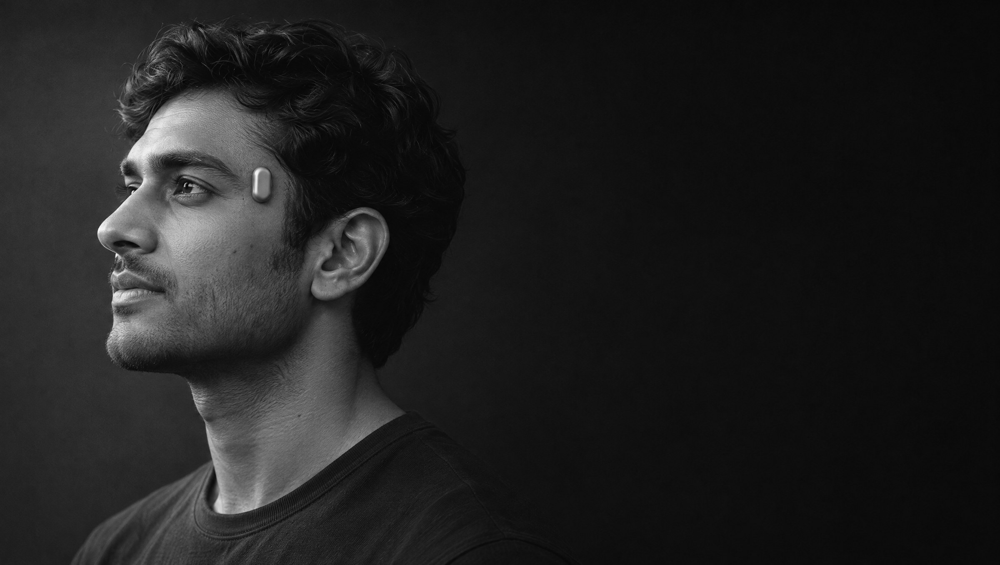
</p>

<p align="center">
  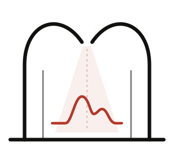
</p>

<h1 align="center">Atrium</h1>

<p align="center">
  <b>An open optical wearable, small enough to forget.</b><br>
  Designed in Ahmedabad by <a href="https://localforge.in">Local Forge</a>.
</p>

<p align="center">
  <a href="docs/quick-start.md">Quick start</a> ·
  <a href="#the-story">Story</a> ·
  <a href="#inside">Inside</a> ·
  <a href="#whats-next">What's next</a> ·
  <a href="#at-a-glance">At a glance</a> ·
  <a href="#get-the-app">Get the app</a> ·
  <a href="#whats-in-this-repository">Repository</a> ·
  <a href="CONTRIBUTING.md">Contribute</a> ·
  <a href="#licence">Licence</a>
</p>

---

## Small. Quiet. Open.

Atrium is a 20.9 × 11 × 5.3 mm pod worn on the temporal region, the flat of the head beside the eye. It reads the skin
with light and motion: pulse, heart-rate variability, skin-temperature trend, sleep and activity. It keeps a log and
syncs it to your phone over Bluetooth LE. A small Plinth charges it, and a pocket case charges it on the go.

<p align="center">
  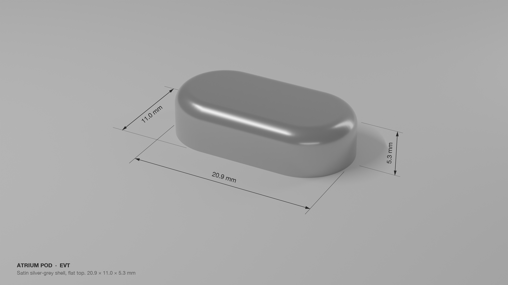
</p>

Every file that defines it is here: schematics, board layouts, Gerbers, BOMs, enclosure CAD and drawings, the
simulations behind the numbers, the firmware for the pod and the case, and the phone app. Read it, build it, change it.

<p align="center">
  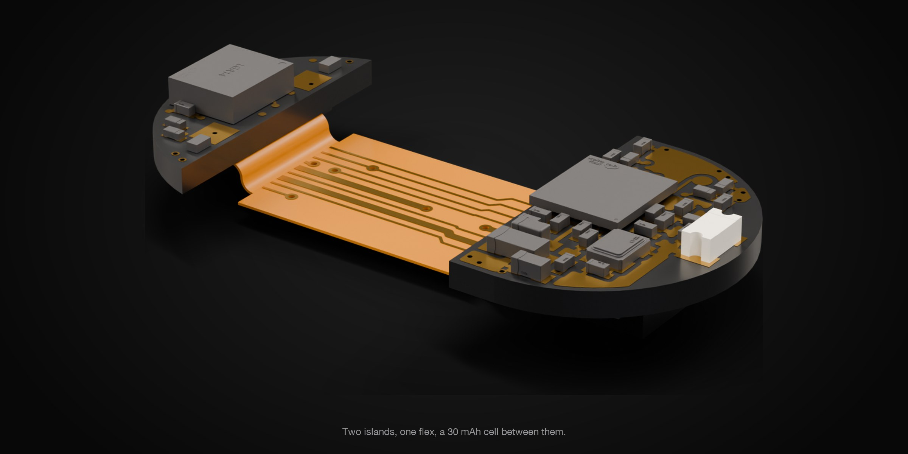
</p>

<p align="center">
  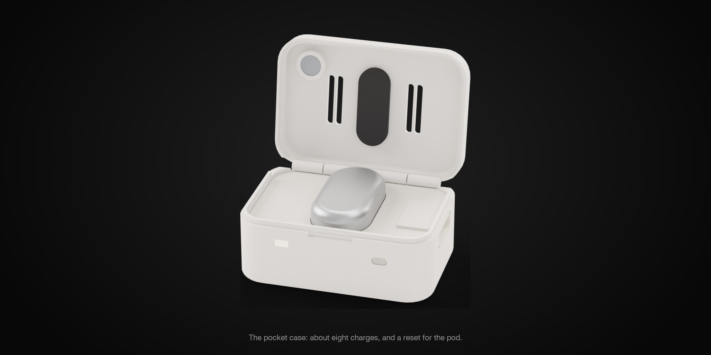
</p>

## Quick start

| I want to | Start here |
|---|---|
| Try the app without a pod | Install the demo APK from [Releases](https://github.com/Het-Bhavsar/Atrium/releases/latest) |
| Read the design | Schematic and PCB PDFs in `hardware/`, drawings in `mechanical/` |
| Build the firmware | `firmware/tests/fw.sh image`, then `test` and `build` (Docker only) |
| Make, flash and pair pods | [`docs/quick-start.md`](docs/quick-start.md) |

## The story

Every great building has a centre. In a Roman house it was the atrium: an open hall with the sky for a roof. Light came
in there, people gathered there, and nothing was hidden. Your heart has one too: the chamber where blood arrives before
every beat.

I named Atrium after both. It reads your pulse with light, and like the hall, it is open: every schematic, every line of
firmware and every data format is public.

It started as a 28 × 14 mm board with a discrete optical front end. That was too big to forget on your head, so I moved
the optics into one module, dropped to a 30 mAh cell, and split the electronics into two small boards in the rounded
ends of the pod, joined by a flex under a centred cell. Each step, and what I tried and left behind, is in
[`docs/story.md`](docs/story.md) and [`legacy/`](legacy/).

<p align="center">
  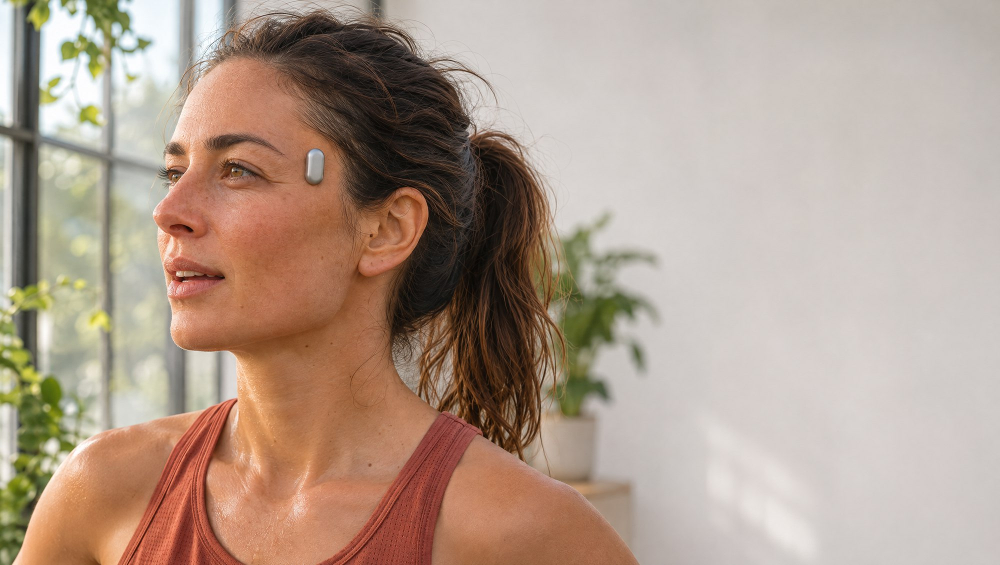
  <br><sub>Worn upright in the temporal hollow, a thumb-width behind the eye. Illustrations, with the pod at true scale.</sub>
</p>

**Atrium. Open to the sky. Open to everyone.**

## Inside

Every board is routed by hand: no autorouter, arc bends on the antenna feed, a copper-free zone under the chip antenna
on every layer, and ground stitching along each edge.

<p align="center">
  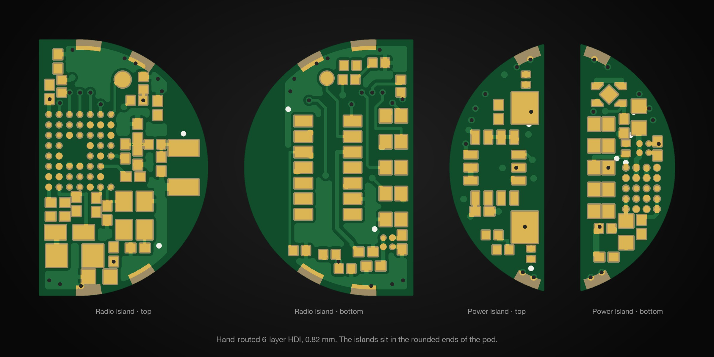
</p>

<p align="center">
  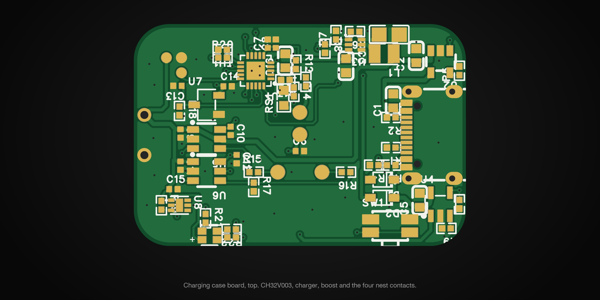
</p>

<p align="center">
  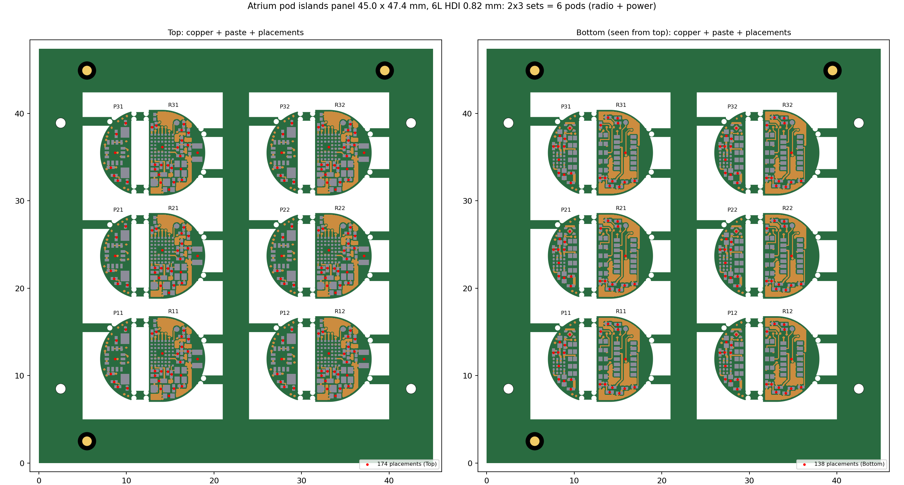
  <br><sub>One 45 × 47.4 mm panel builds six pods: one PCB order, one stencil per side, one assembly run.</sub>
</p>

## What's next

The EVT build is about proving the basics on real heads. While that happens, these are the three directions I care
most about.

**Smaller, with a custom cell.** The pod is 20.9 mm long today because the cell is an off-the-shelf 9 × 9 × 4 mm
pouch, and the radio island, cell and power island have to sit in a row. With a cell made to the shape of the shell I
think we can bring the pod to around 17 mm. That is the size I wanted from the start, and the first thing I will chase
after EVT.

**A voice on the head.** The temporal region sits right on the bone. The next version could add bone-conduction audio and
a voice pickup, so you can tap the pod and talk to an AI assistant, with the answer heard through
the bone and nothing in your ear. It is designed on paper and deliberately left out of EVT, so this build stays simple.

**Looking deeper.** I wanted to know if a pod this small could see blood flow in the brain, so we tried two ways.

- *The usual way*, which Atrium uses: green, red and infrared light with the LEDs and the photodiode a couple of
  millimetres apart. Our photon simulations say this light stays in the scalp. Green sees nothing deeper, and in red and
  infrared the brain's share of the pulse is well under a tenth of a percent.
- *The fNIRS way*: near-infrared light with the source and the detector about 3 cm apart, so the light travels deep
  enough to reach the brain before it comes back. The same model puts about a tenth of the signal in the brain at that
  spacing, which matches published work.

So a 20 mm pod can't see the brain, and I would rather say that plainly than claim it. A 3 cm optical path needs a
different shape, a band or a longer pod, and careful validation. It is on the research list, not in this product.
Atrium today is a wellness device: pulse, heart-rate variability, sleep and skin temperature, nothing more.

If any of this is the part you want to build, start with the [roadmap](docs/roadmap.md) and open an issue.

— Het

## At a glance

| | |
|---|---|
| **Pod** | 20.9 × 11 × 5.3 mm capsule, flat top, satin silver-grey (NCVM on PC, non-conductive for the antenna) |
| **Boards** | Two rigid 6-layer HDI islands, 0.82 mm (1+4+1, laser microvias, filled via-in-pad), joined by a 2-layer polyimide flex under the cell |
| **Radio** | Bluetooth LE, nRF52832 WLCSP; KH-1608 chip antenna at the tip, 50 Ω coplanar feed with arc bends, copper-free on every layer under the antenna |
| **Optics** | MAXM86161 module (green, red and infrared LEDs, photodiode, front end) behind a pill window |
| **Other sensors** | LSM6DSOX motion, a skin NTC and a top NTC |
| **Power** | 30 mAh Li-po (9 × 9 × 4 mm), BQ21061 charger, AP6683 protection, 1.8 V rails; about 4 days in the default mode (to be measured on EVT units) |
| **Charging** | ENIG contacts on the skin side: VIN at the centre and ground either side, so it charges either way round, plus two SWD contacts for the programming jig. A steel stiffener and two magnets hold it on the Plinth |
| **Case** | 2-layer board: CH32V003 MCU, linear charger, 5 V boost and current limit into the pod; about 8 pod charges per case charge |
| **Wear** | Upright, window end up. A hidden 0.15 mm disposable pad in a bed under the pod; nothing shows |
| **Build** | Parts from the LCSC / JLCPCB catalogue; both islands on one panel for one PCBA order |
| **Software** | Pod firmware on Zephyr (nRF Connect SDK), case firmware for the CH32V003, Flutter app for Android and iOS. No account and no cloud: data stays on the phone |


## Get the app

<p align="center">
  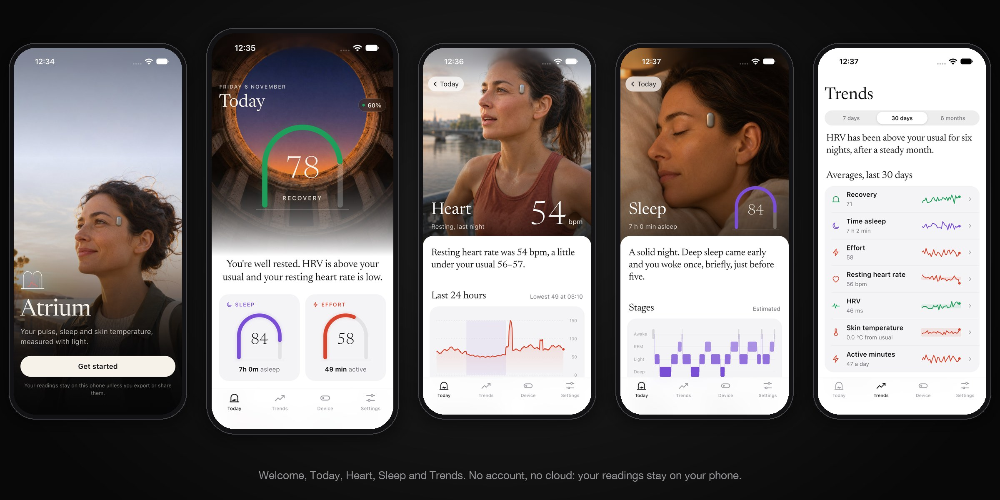
</p>

<p align="center">
  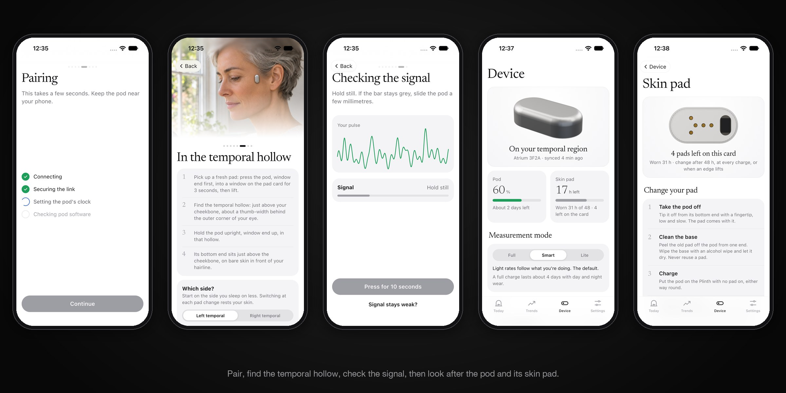
</p>


The Android app is on the [Releases page](https://github.com/Het-Bhavsar/Atrium/releases/latest):

- `atrium-…-demo-arm64-v8a.apk`: sample data, no pod needed. Start here.
- `atrium-…-pod-arm64-v8a.apk`: talks to a real pod over Bluetooth.
- `armeabi-v7a` builds for older phones.

The iOS app builds from `app/android-ios` with Flutter (see its README).

## What's in this repository

```
hardware/
  pod/radio-island/      schematic (SchDoc, PDF, SVG) · pcb (PcbDoc, PDF, STEP, renders) · production (Gerbers, BOM, CPL, IPC netlist)
  pod/power-island/      same
  pod/flex-jumper/       same
  pod/islands-panel/     the 2 × 3 panel of both islands: PcbDoc, Gerbers, BOM, CPL, order notes
  case/charging-case/    same as the islands
  design-data/           netlist, pin map, PCB and flex rules, board outlines (DXF)
  simulation/            reports: RF chain, impedance, link budget, optics, power, charging, thermal, assembly
  stencil-report.md      stencil area ratios for every board
mechanical/
  pod/ case/ plinth/ programming-jig/ packaging/    drawings (PDF) · STEP · STL · GLB · DXF
  renders/                                          product and section renders
firmware/                pod (Zephyr) and case (CH32V003) firmware with tests
app/android-ios/         Flutter app for Android and iOS
docs/                    story, architecture, mechanical, placement, charging case, build and test, features, BLE GATT, brochure
legacy/                  earlier revisions and concepts, with why each was dropped
```

The `.SchDoc` and `.PcbDoc` files are Altium format, exported from EasyEDA Pro, and open in Altium Designer and in KiCad
(File → Import). The PDFs and Gerbers need no EDA tool.

## Status

Engineering validation (EVT).

| | |
|---|---|
| Schematics | Captured and checked against the netlist |
| Boards | Hand-routed: radio and power islands (6-layer HDI), flex jumper, charging case. DRC clean |
| Production files | Gerbers, BOM, CPL and a 2 × 3 islands panel ready to order |
| Enclosure | Pod, skin pad, Plinth, case, jig and packaging CAD with fit checks and drawings |
| Firmware | Pod and case firmware build; unit tests pass |
| App | Android and iOS app with demo and real-pod modes; v0.1.0 APKs |
| First units | Not built yet |

Open engineering items are tracked in [`docs/open-items.md`](docs/open-items.md).

## Contributing

Atrium is built in the open and welcomes help: firmware, the app, signal processing, mechanical, testing on real heads,
documentation. Start with [`CONTRIBUTING.md`](CONTRIBUTING.md) and the [roadmap](docs/roadmap.md).

## Not a medical device

Atrium is for wellness and research. It does not diagnose, treat or prevent any condition, and its readings must not be
used for medical decisions.

## Licence

Copyright 2026 Local Forge. Source location: <https://github.com/Het-Bhavsar/Atrium>.

| Folder | What it covers | Licence | SPDX |
|---|---|---|---|
| `hardware/`, `mechanical/` | Schematics, layout, production files, CAD, drawings, simulations | [CERN Open Hardware Licence v2, Strongly Reciprocal](LICENSE) | `CERN-OHL-S-2.0` |
| `firmware/` | Pod and case firmware | [Apache License 2.0](firmware/LICENSE) | `Apache-2.0` |
| `app/` | Phone app | [Apache License 2.0](app/LICENSE) | `Apache-2.0` |
| `docs/`, `legacy/`, `README.md` | Documentation and images | [Creative Commons Attribution-ShareAlike 4.0](docs/LICENSE) | `CC-BY-SA-4.0` |

- **Hardware.** CERN-OHL-S-2.0 is strongly reciprocal: if you make and convey a product from these files, or a modified
  version of them, you must make the complete source of your version available under the same licence, keep the
  copyright and licence notices, and keep or add a source location that points to it.
- **Software.** Apache-2.0 allows use, change and redistribution, including commercial, with a patent grant. Keep the
  licence and copyright notices and mark the files you change.
- **Documents.** CC BY-SA 4.0 requires credit ("Atrium by Local Forge", with a link to the source location), a link to
  the licence, a note of changes, and the same licence on adaptations.
- **Names and marks.** The licences cover the design, code and text. They do not grant rights to the names "Atrium" and
  "Local Forge" or their logos. A product built from these files must not suggest that Local Forge made or endorses it.
- **No warranty.** Each licence disclaims all warranties and liability to the extent the law allows.

Atrium aims for [OSHWA certification](docs/certification.md) at its first public release.
