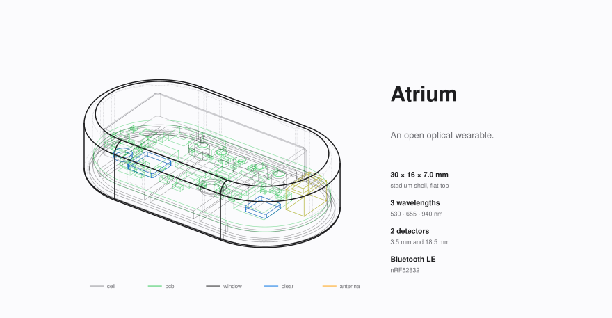
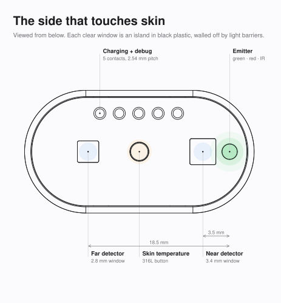
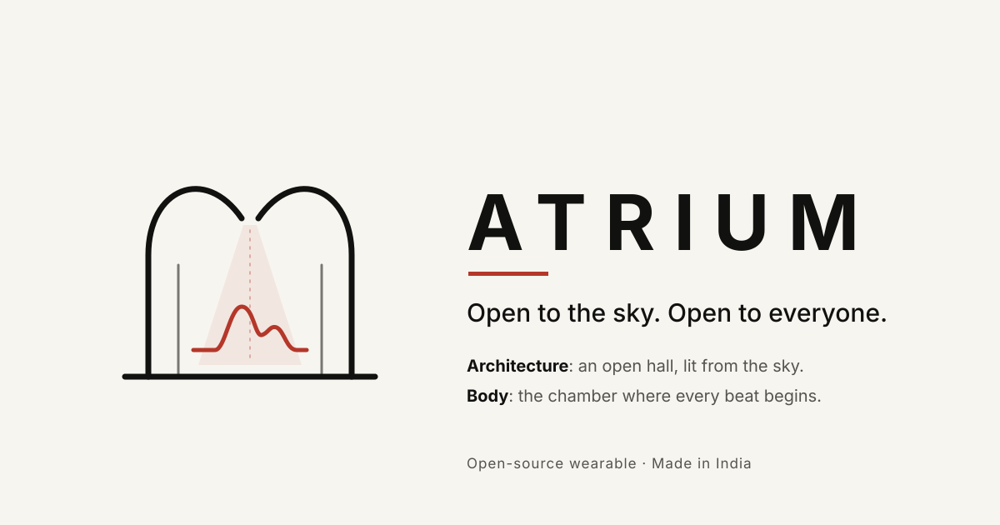
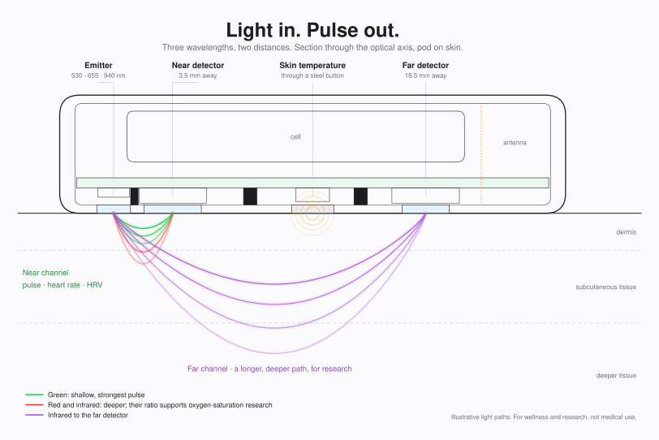
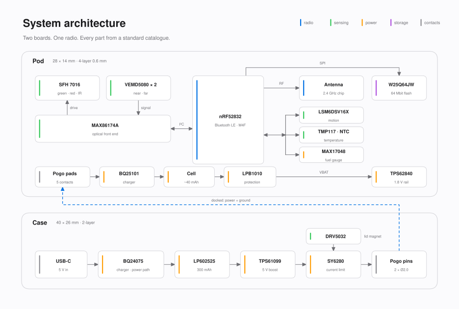
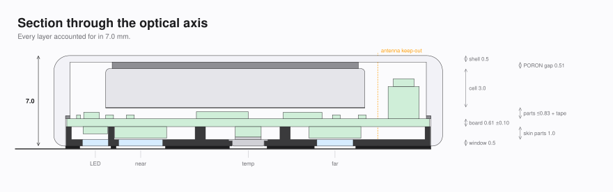
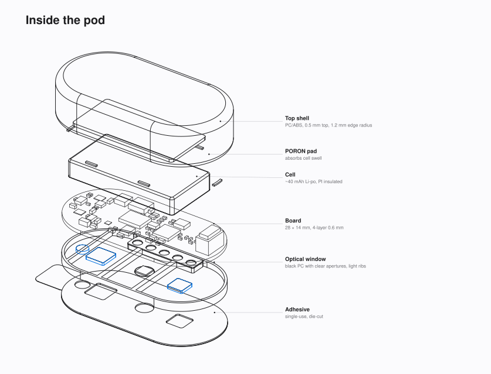
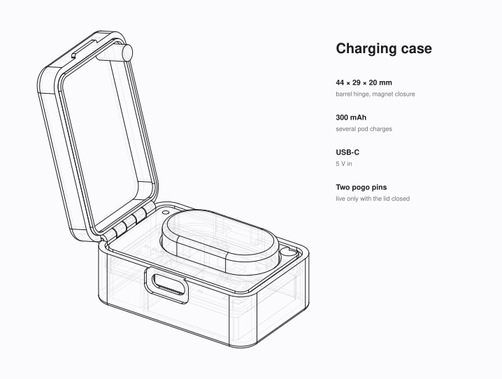

<p align="center">
  
</p>

<p align="center">
  
</p>

<h1 align="center">Atrium</h1>

<p align="center">
  <b>An open optical wearable.</b><br>
  Designed in Ahmedabad by LocalForge.
</p>

<p align="center">
  <a href="#why-atrium">Why Atrium</a> ·
  <a href="#at-a-glance">At a glance</a> ·
  <a href="#how-it-senses">How it senses</a> ·
  <a href="#inside">Inside</a> ·
  <a href="#status">Status</a> ·
  <a href="#repository">Repository</a> ·
  <a href="#licence">Licence</a>
</p>

---

## Small. Quiet. Open.

Atrium is a 30 × 16 × 7 mm pod that sits against the skin and reads it with light. It measures
pulse, temperature and motion, logs them, and sends them over Bluetooth LE. A pocket case charges it.

Every file that defines it lives here: schematics, boards, enclosure CAD, the simulations behind
the numbers, and, as it is written, the firmware. You can read it, build it, and change it.

<p align="center">
  
</p>

## Why Atrium

<p align="center">
  
</p>

Every great building has a centre. In a Roman house it was the atrium: an open hall with the sky for a roof. Light came in there, people gathered there, and nothing was hidden.

Your heart has one too. The atrium is the chamber where blood arrives before every beat. Every pulse you've ever felt started there.

We named our wearable after both. Atrium reads your pulse with light, and like the hall it's named after, it's open. Every schematic, every line of firmware and every data format is public, for anyone to read, build and improve.

**Atrium. Open to the sky. Open to everyone.**

**The mark**
- **Building:** an open hall whose roof is the two lobes of a heart.
- **Gap at the centre:** the open roof, where a soft red beam of light falls in.
- **Floor:** a pulse waveform, the real PPG shape Atrium measures, not a hospital ECG spike.

## At a glance

| | |
|---|---|
| **Pod** | 30 × 16 × 7.0 mm stadium shell; 28 × 14 mm board, 4-layer 0.6 mm HDI |
| **Radio** | Bluetooth LE, nRF52832, chip antenna at the far end |
| **Optics** | SFH 7016 emitter (530 / 655 / 940 nm), two VEMD5080 detectors at 3.5 mm and 18.5 mm, MAX86174A front end |
| **Other sensors** | TMP117 skin temperature through a 316L button, edge NTC, LSM6DSV16X motion |
| **Storage** | 64 Mbit flash for offline logging |
| **Battery** | ~40 mAh Li-po with on-board protection and fuel gauge; modelled average draw 0.23 to 0.96 mA, depending on mode |
| **Charging** | Two pogo pins in a case with a 300 mAh cell and USB-C; the pins go live only with the lid closed |
| **Wear** | Single-use medical-grade adhesive patch; skin-side window in black PC with clear apertures |
| **Build** | Every part from the LCSC / JLCPCB catalogue, assembled by standard PCBA |

## How it senses

<p align="center">
  
</p>

- **Near channel.** Green light travels 3.5 mm through the top layers of skin to the near detector. That gives a strong pulse waveform, from which come heart rate and heart-rate variability.
- **Red and infrared.** The same detectors read red and infrared, which penetrate deeper. Their ratio is the basis of oxygen-saturation research.
- **Far channel.** Infrared reaching the detector 18.5 mm away has taken a longer, deeper path. It is recorded as a research signal.
- **Temperature.** A steel button carries skin heat to the TMP117. A second sensor at the shell edge gives a reference for heat-flux estimates.
- **Motion.** The IMU flags movement, so motion-corrupted samples can be rejected.

Light barriers sit between every aperture, and each clear window is an island in black plastic, so no light leaks sideways.

## Inside

<p align="center">
  
</p>

<p align="center">
  
</p>

<p align="center">
  
</p>

<p align="center">
  
</p>

## Status

Engineering validation (EVT), revision B.1.

| | |
|---|---|
| Schematics | Captured, ERC clean |
| Enclosure CAD | First model with interference, stack-up and fit checks; open items in [`hardware/README.md`](hardware/README.md) |
| Board layout | In progress |
| Firmware | Not started |
| App | Not started |
| First units | Not built |

## Repository

```
hardware/
  pod/   schematic · pcb · bom · mechanical · production
  case/  schematic · pcb · bom · mechanical · production
  simulation/        power, signal, thermal, RF and SPICE models
firmware/            nRF52832 firmware: src · drivers · boards · tests
app/                 android-ios · python (data tools)
cloud/               optional sync backend
docs/                certification plan, figures
```

The enclosure is parametric (build123d). To rebuild it, run
`cad run pod_assembly.py` in `hardware/pod/mechanical/src`. Each folder's README covers its own build steps.

## Licence

| Part | Licence |
|---|---|
| Hardware: schematics, layout, CAD, BOM | [CERN-OHL-S-2.0](LICENSE) |
| Firmware, app, cloud | [Apache-2.0](firmware/LICENSE) |
| Documentation and images | [CC BY-SA 4.0](docs/LICENSE) |

Atrium aims for [OSHWA certification](docs/certification.md) at its first public release.

## Not a medical device

Atrium is for wellness and research. It does not diagnose, treat or prevent any condition, and its
readings must not be used for medical decisions. Drawings are projected from the working CAD.
