# App

  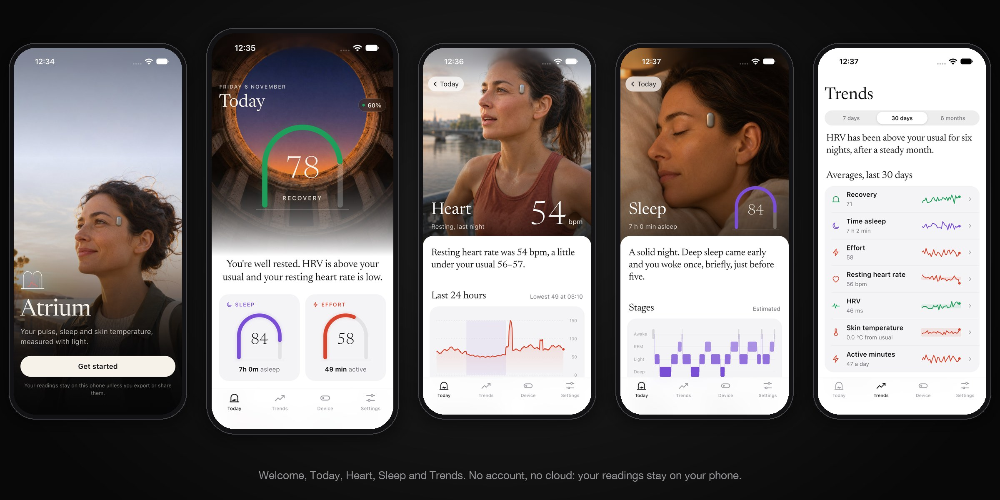

  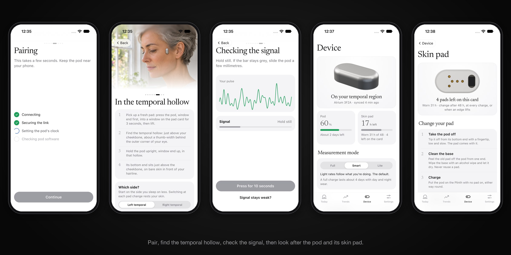

| Folder | Contents |
|---|---|
| `android-ios/` | The Atrium phone app (Flutter, Android and iOS): pairing, fit guide, daily views, sync and pod updates. Build and run steps are in its README |

Prebuilt Android APKs are on the [Releases page](https://github.com/Het-Bhavsar/Atrium/releases/latest). Licence:
Apache-2.0 (see `LICENSE`).

## Every screen

From the demo build on an iPhone 17 Pro simulator.

<table>
<tr><td align="center">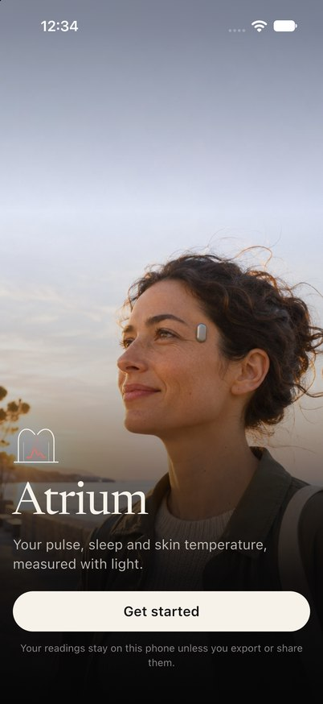 Welcome</td><td align="center">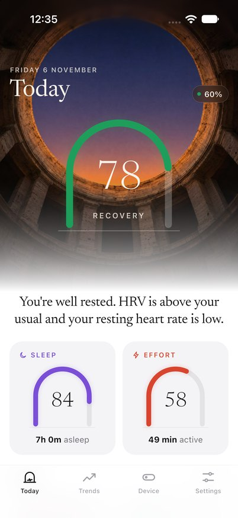 Today</td><td align="center">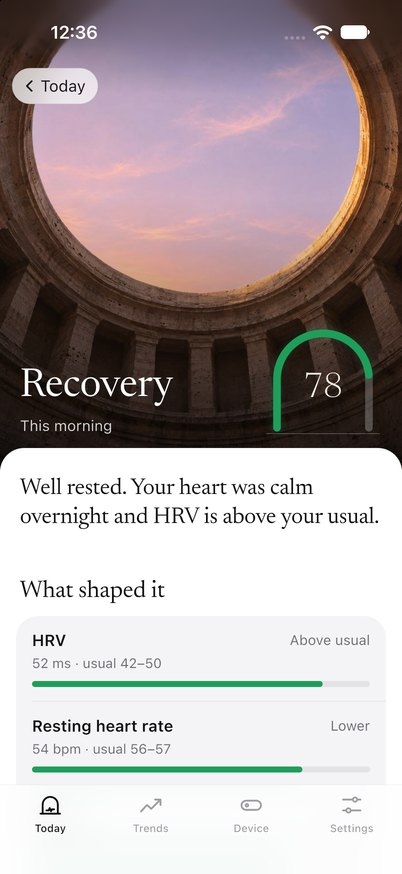 Recovery</td><td align="center">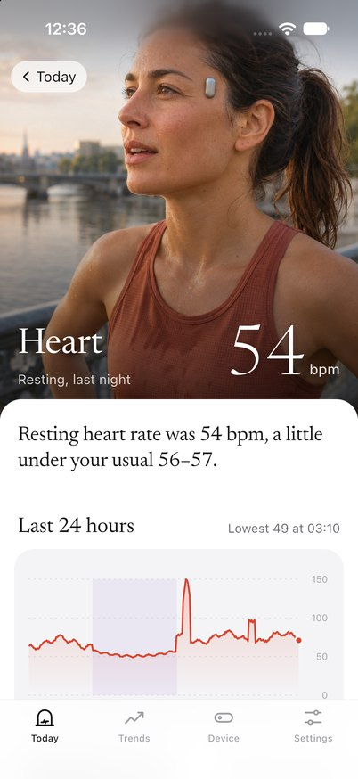 Heart</td></tr>
<tr><td align="center">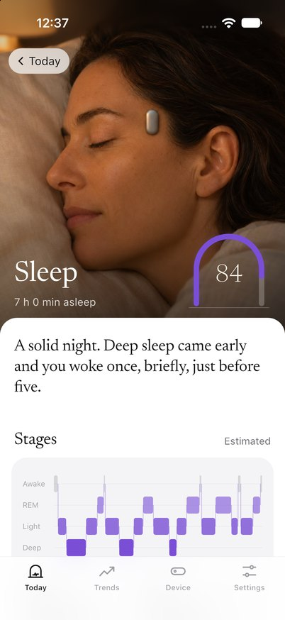 Sleep</td><td align="center">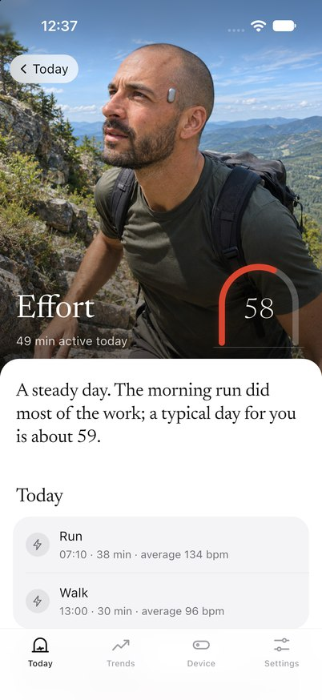 Effort</td><td align="center">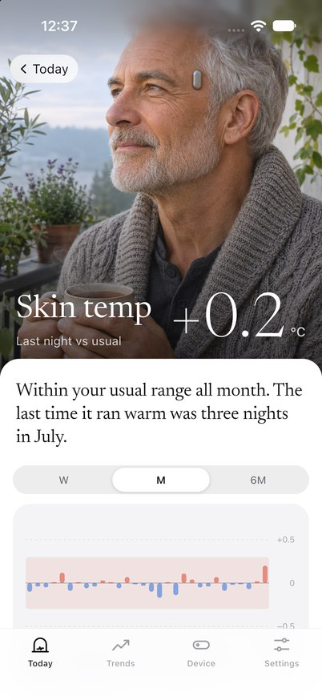 Skin temperature</td><td align="center">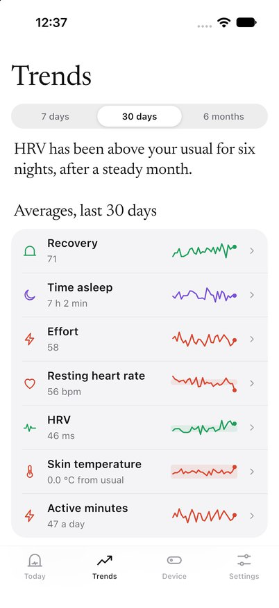 Trends</td></tr>
<tr><td align="center">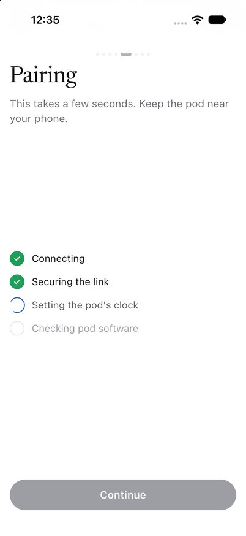 Pairing</td><td align="center">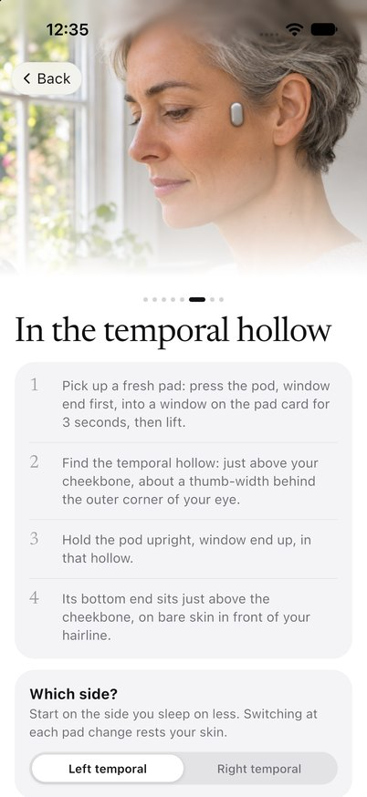 Placement</td><td align="center">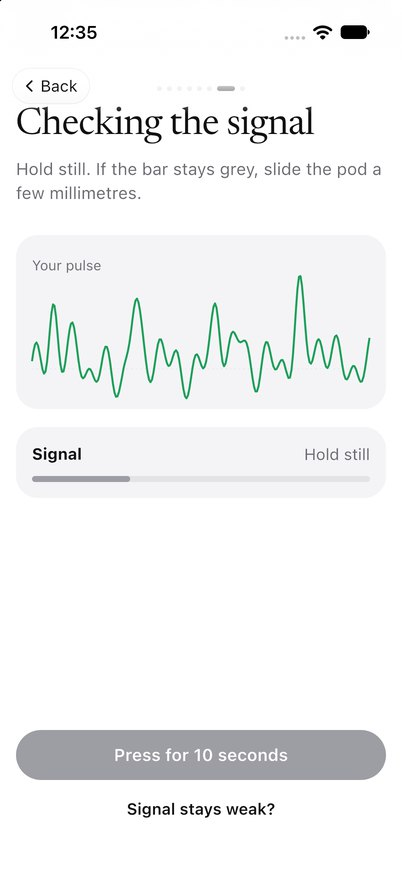 Signal check</td><td align="center">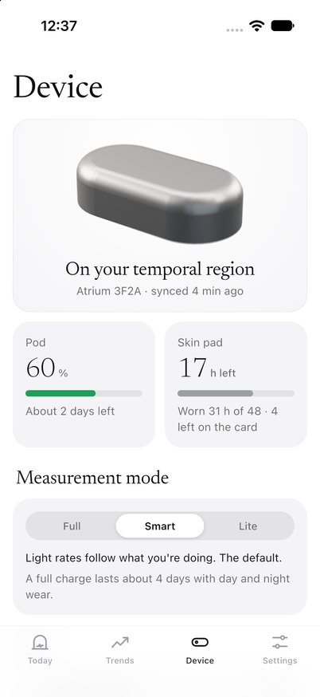 Device</td></tr>
<tr><td align="center">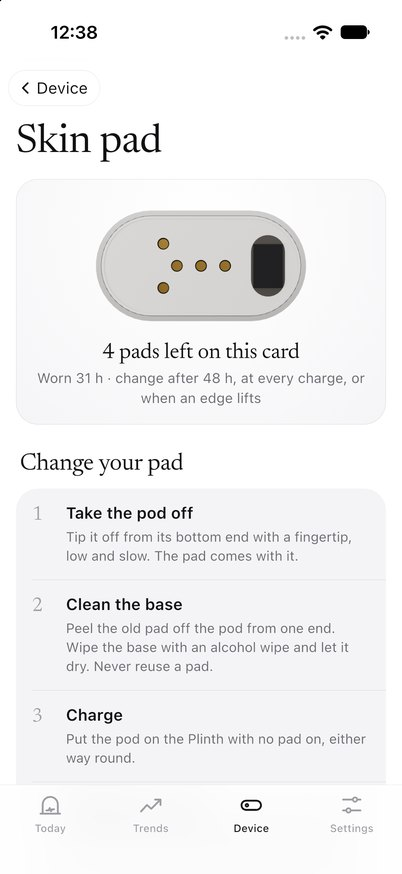 Skin pad</td><td align="center">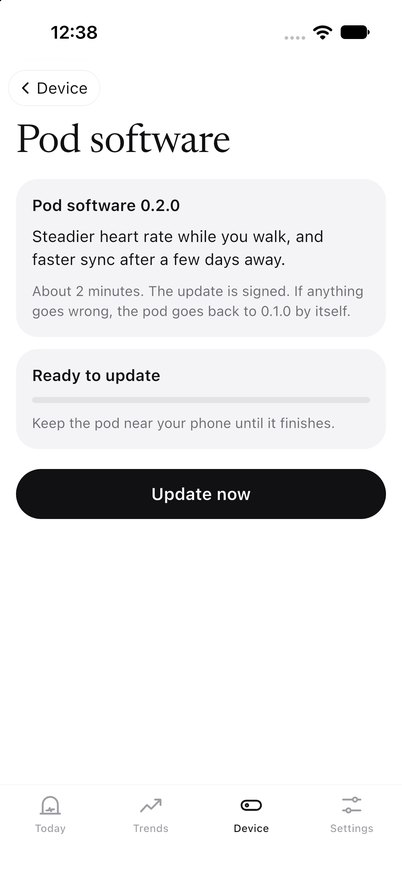 Pod software</td><td align="center">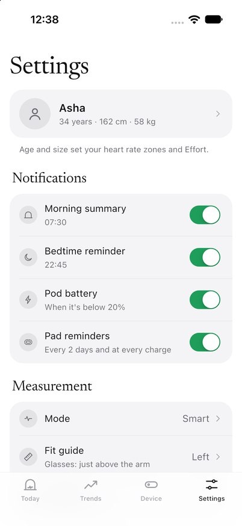 Settings</td></tr>
</table>
