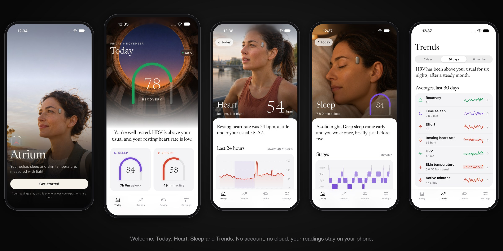

# Atrium app (Flutter)

Atrium is made by Local Forge ([localforge.in](https://localforge.in)).

<p align="center">
  
</p>


The phone app for the Atrium pod: pairing, fit guide, Today, Recovery, Heart, Sleep (with sleep head position), Effort, Skin temperature, Trends, Device, Skin pad, Pod software and Settings.
- **Bundle id:** `open.atrium` on iOS and Android.
- **Design:** `design/` (the clickable prototype and its README).
- **Plan:** `BLUEPRINT.md`.
- **Features:** numbered as in `docs/FEATURES.md`.
- **Pod interface:** `docs/ble_gatt.md`. The app is built to rev 13; revs 14–16 add only research modes and the charging-case flag, so it works with the rev 16 firmware.

Wellness and research only. No screen makes a medical claim.

## Run

Uses the installed Flutter stable (3.47, Dart 3.13). From `app/android-ios`:

```
flutter pub get
flutter test
flutter run                                       # starts at onboarding
flutter run --dart-define=ATRIUM_START=/today     # jump straight to a screen
flutter run --dart-define=ATRIUM_REAL_DATA=true   # real pod data instead of the demo set
```

### Demo or real data

One build switch, `ATRIUM_REAL_DATA` (`lib/core/config.dart`), picks the data:

| | Demo (default) | Real (`--dart-define=ATRIUM_REAL_DATA=true`) |
|---|---|---|
| Metrics | The prototype's sample set (`sample_data.dart`). It uses the same seeded RNG, so the numbers match the prototype; `test/sample_data_test.dart` checks this. | `PodMetrics`, computed from the synced log (`pod_metrics.dart`) |
| Pod status | The demo situations | Live Charge State notifications |
| Pairing, fit guide | Simulated | Real scan, pair, clock set, Fit Quality (0x0206) and heart rate (0x2A37) |
| Device | Simulated | Mode writes 0x0601 and ship mode writes 0x0605; Search again reconnects; last sync time and the pod's software version (DIS 0x2A26) |
| Today | Static | Pull to sync the log; last sync time, and "Sync soon" once it is over 16 h old |
| Pod software | A simulated run, labelled "Demo" on screen; it never says "updated" | The latest signed GitHub release, sent over MCUmgr SMP (see "Pod software update") |
| Sleep, oxygen trend (Labs) | Hidden | With Labs on and 7 earlier nights: last night's red/IR ratio as a multiple of the user's own baseline, never a percentage |

Synced epochs are kept on the phone in `epochs.bin` (`epoch_store.dart`), which re-decodes with the log decoder. The time of the last sync is kept beside it (`epochs.bin.synced`), so Today and Device show its age after a restart or out of the pod's reach. Recovery, Sleep score and Effort show the learning state, because their formulas don't exist yet. Real builds show only plain sentences about what the log holds, not the demo stories.

### Phone-side algorithms

The pod computes pulse, per-epoch RMSSD, wear, activity, steps, fit quality, pitch and roll, skin temperature and oxygen bursts. The phone computes what needs a whole night, several nights, the wear side or local time. These are ports of the ML reference models:

| Step | Dart |
|---|---|
| Night window, rest run, 30 s grid | `nightly.dart` |
| Sleep/wake (logistic model), stages (Labs) | `sleep_model.dart` with `assets/models/sleep_v1.json` |
| Sleep period, wake-ups, resting HR, pooled RMSSD, skin temperature, positions, oxygen ratio | `nightly.dart` (`summarise`) |
| 14-night baseline and deviation (5 nights minimum) | `nightly.dart` (`deviation`) |
| Upright calibration, restarted at each pad change | `nightly.dart` (`uprightFromLog`), `AppState.padChangedAt` |
| Fit press (8 of 10 s) and guided side tilt | `pod/domain/fit_checks.dart` |

`test/nightly_test.dart`, `test/pod_metrics_test.dart` and `test/fit_checks_test.dart` check the port against the ML vectors in `test/fixtures/phone` and `test/fixtures/fit`: features and P(asleep) within 1e-6, minutes and counts equal, bpm, ms and °C within 0.01. The model is data: a retrained `sleep_v1.json` ships without a code change. It was trained on 31 wrist nights (sleep-accel 1.0.0, ODC-By 1.0, credited under Settings > Open source), so sleep is shown as an estimate until it is retrained on pod nights. Every threshold in `NightConfig` is [ASSUMED].

### Privacy: no account, no cloud

Atrium has no accounts and no server: the phone talks to the pod directly over Bluetooth.
- Onboarding asks for a name, age, height and weight. They're saved in `profile.json` in the app's private folder, and Settings edits them.
- Readings live in `epochs.bin` beside it.
- Both are encrypted at rest by the OS (iOS Data Protection, Android file-based encryption).
- **Log out** (Settings, at the bottom) clears this phone: it forgets the pod (`forgetPod`), deletes the readings and the profile, resets settings except the theme, and returns to Welcome. **Delete all data** removes only the readings; **Forget this pod** (Device) only unpairs.
- The only network request is the pod software check: opening Device > Pod software fetches the latest release of `Het-Bhavsar/Atrium` from the GitHub API and, if you update, its `atrium-pod-<version>.bin` asset. Nothing about you or the pod is sent. Android's release manifest declares `INTERNET` for it.
- Both are kept out of backups: iOS marks the folder excluded from iCloud and computer backup (`FilesHostApi.keepOnDevice`); Android turns backup and device transfer off in the manifest.
- The Bluetooth link's security (LE Secure Connections pairing, an encrypted link, pairing only just after a lift from the Plinth) is set by the pod firmware; see `docs/ble_gatt.md`.

### Deep links (debug builds)

`atrium:///<route>?<state>` opens any screen in any demo state. The keys are the prototype's: `build=evt`, `dev=charging|full|cold|syncdue|notfound|offskin`, `data=empty|learning`, `glasses=yes|no`, `labs=1`, `sheet=box|plinth-info`. Add `y=<pt>` to scroll. Example:

```
xcrun simctl openurl booted "atrium:///today/sleep?dev=charging&y=700"
```

This is how the HTML-vs-Flutter comparison is shot. The comparison goes to `design/compare/`, which git ignores because it holds pod imagery.

## Motion and code style

- **Motion:** shared tokens in `Motion` (`tokens.dart`).
  - Tabs fade in when chosen (`FadeIndexedStack`).
  - Page content eases in (`Reveal`).
  - Gauges sweep and their numbers count up; cover numbers count up too.
  - Charts draw in, and redraw when the range changes.
  - The segmented thumb slides.
  - Tabs, segments and chart scrubbing give a light haptic tick.
- **Reduce Motion:** with the system setting on (iOS Reduce Motion, Android "Remove animations"), everything lands at once (`Motion.of`, `Motion.reduced`).
- **Code:** formatted at 160 columns (`formatter.page_width` in `analysis_options.yaml`). Lints are `flutter_lints` plus package imports, ordered directives, final locals, unawaited futures, and strict casts and raw types. Run before committing:

```
dart format lib test pigeons
flutter analyze
flutter test
```

## Layout

| Path | What |
|---|---|
| `lib/core/theme/` | Design tokens (colours, type, spacing, radii, motion) and the theme |
| `lib/core/widgets/` | Arch gauge, charts, hypnogram, cards, list rows, cover page, tab shell |
| `lib/core/app_state.dart` | App state (Riverpod) |
| `lib/core/routes/` | `go_router` table |
| `lib/features/onboarding/` | Welcome to Baseline (#15, #17, #23–#26) |
| `lib/features/today/` | Today (#1, #3, #13) |
| `lib/features/metrics/` | Recovery, Heart, Sleep, Effort, Skin temperature, Trends (#1–#7) |
| `lib/features/device/` | Device, Skin pad, Pod software, sheets (#16–#21, #25–#27) |
| `lib/features/settings/` | Settings and Labs (#8–#12, #14, #22, #23) |
| `lib/features/pod/` | Pod entities, the log decoder and the Pigeon API |
| `pigeons/pod.dart` | Pigeon contract; regenerate with `dart run pigeon --input pigeons/pod.dart` |
| `ios/Runner/PodHost.swift` | CoreBluetooth host with state restoration (background mode `bluetooth-central`) |
| `android/app/src/main/kotlin/open/atrium/PodHost.kt` | Android BLE host (serialized GATT operations) |
| `test/` | Checks against the Python references: the log decoder against the reference log vectors and head position against the reference vectors. Also: `PodMetrics` on a synthetic log, every screen with an empty pod log, and demo data against the prototype |

## Native pod link

Flutter talks to the pod through Pigeon (`PodHostApi`, `PodFlutterApi`):
- **Native side:** scans for the Power service (0x0100), connects, bonds, reads, writes and notifies by the 16-bit ids in `ble_gatt.md`. It also downloads the log (Log Control 0x0502 op 0x01, pages on 0x0503) and finishes on the pod's end indication (0x90 on 0x0502), with a 10 s idle fallback for disconnects and older firmware.
- **Realtime:** after each connect the app subscribes to Live Epoch 0x0504. Each 30 s record goes straight into the store, and the screens refresh at most every 5 min. A head page more than one past the sync cursor starts a sync. The full sync on connect fills any missed records.
- **Uptime records:** records stamped with pod uptime (bit 31, after a reboot) wait for a sync, which moves the current boot's run onto Unix time. Known gap [VERIFY]: a previous boot that ended at a lower uptime than the current boot's first record is joined to the current run and mis-dated; the log has no boot marker.
- **Dart side:** decodes the log pages with `log_record.dart`, a port of the log reference decoder checked bit for bit against it.
- **Firmware update:** `mcumgr_flutter`, Nordic's own plugin (see below).
- **Health:** the `health` package.

## Sync status (#20)

The pod's log is 8 pages of 4 KB, about 20 h, and the oldest page is erased when it is full; the battery lasts days longer. So real builds show "Last synced …" on Today (under the story, and in the empty state) and on Device (caption, Last sync row, and in the not-nearby card), and a "Sync soon" notice once the last sync is more than 16 h old: "sync soon or older readings will be overwritten" (`pod/domain/sync_age.dart`, `pod/presentation/sync_status.dart`). A full sync and live records (Live Epoch 0x0504, saved at most every 5 min) both count as synced. `docs/FEATURES.md` #20 still says the app warns after 12 h; the app uses 16 h, 4 h before the log starts overwriting.

## Pod software update (#21)

Real builds (`device/domain/firmware_update.dart`, `device/data/`, `device/presentation/firmware_view.dart`):

1. **Check.** The pod's version is DIS Firmware Revision 0x2A26 (`0.1.0+<commit>`, read at every connect). The latest release is `GET https://api.github.com/repos/Het-Bhavsar/Atrium/releases/latest`, asset `atrium-pod-<version>.bin` (`zephyr.signed.bin`). Newer than the pod: Update; otherwise Up to date. No release, or the repository not public: "No pod software has been published yet."
2. **Gate.** On the Plinth (or in the case) it may start. Off it, the pod refuses below 3.60 V VSYS (ble_gatt.md section 9), so the app reads VSYS from Charge State bytes 6–7 and refuses below 3.60 V or with the low-battery state; with no voltage reading it asks for the Plinth.
3. **Download and check the file.** Size within 216.9 KB, MCUboot header magic, a TLV block after the image, and the header's version equal to the asset's. A file that fails any of these is never sent.
4. **Hand-over.** Native code owns the app's BLE link, and `mcumgr_flutter` opens its own (iOS: its own `CBCentralManager` to the same peripheral UUID; Android: its own GATT client to the same address). `PodSession.handOver` marks the session handed over (no reconnects, syncs, live records or status writes), waits for a running sync (up to 30 s), stops the live listeners and calls `PodLink.release`: `disconnect` on the native host, then waits for its disconnected event (5 s at most). Native doesn't reconnect by itself on either platform, so nothing competes with MCUmgr.
5. **Upload.** `McumgrTransport`: `updateWithImageData`, mode `testOnly` (upload, test, reset), `eraseAppSettings` off (the settings partition holds the pod's bonds), progress from `progressStream`, failure from the state stream's errors, a 60 s stall timeout, Stop cancels. The pod confirms the image itself after 60 s of healthy running (`firmware/src/dfu_health.c`); an unconfirmed image reverts on the next reset.
6. **Verify.** After a 10 s swap wait [ASSUMED], `PodSession.takeBack` reconnects (one pending connect on iOS, retries every few seconds on Android, 3 min in all), reads 0x2A26 again and resumes syncing. Only a pod that reports the release's version shows "Updated". The old version, no answer, an upload error or Stop each show what happened and which version the pod is on.

Native changes for this (small, both platforms): `disconnect()` now also cancels a connect that is still pending and fails its waiter, and a dropped link fails the read, write and connect calls still waiting, so the retry loop and the hand-over never hang (`ios/Runner/PodHost.swift`, `android/.../PodHost.kt`).

Demo builds run a timer instead, say "Demo" on every state, and finish with "Demo finished. Nothing was sent to a pod." No version numbers are written into the app.

Picking a local `.bin` file isn't offered: it needs a file-picker plugin (native code on both platforms) the app doesn't carry yet.

## Build notes

- **iOS:** Swift Package Manager resolves Nordic's `ios-nrf-connect-device-manager` to 1.14.9. `mcumgr_flutter` 0.10.1 doesn't compile against 1.15, so keep the pin in both `Package.resolved` files.
- **Android:** compiled against API 37 (`android-37.0`) with minSdk 26 (Health Connect). `android/build.gradle.kts` builds `mcumgr_flutter` with a Java 17 target, and `settings.gradle.kts` declares the Wire plugin it needs.

## Not done yet

| Item | Where it stands |
|---|---|
| Pod data | Wired behind `ATRIUM_REAL_DATA` and checked on the simulator with no pod (empty and not-connected states). Not yet run against a real pod. |
| Permissions | Asked at the onboarding step that explains them (`pod_permissions.dart`, `PermissionHostApi`): Nearby devices on Android 12+, location permission and Location on for Android 8-11, notifications on Android 13+ and iOS. iOS starts Bluetooth only then, or at launch once a pod is paired (state restoration). Health (HealthKit, Health Connect) permissions come with that feature. |
| Android background sync | Not written: no foreground service or companion-device association, so the log syncs only while Atrium is open (connect, pull to refresh, Live Epoch). `setBackgroundSync` just stores the wish. Today and Device warn after 16 h without a sync instead. |
| iOS background refresh | Not written: no `BGAppRefreshTask`. State restoration (`bluetooth-central`) can relaunch the app for pod events, but nothing schedules a sync. The 16 h warning covers it. |
| Pod software update | Built and tested against fakes (GitHub, MCUmgr, the native host). Not yet run against a real pod: the MCUmgr hand-over, the 10 s swap wait and the reconnect timing need an nRF52 DK. |
| Oxygen trend | Shown on Sleep with Labs on after 7 earlier nights; checked on the reference night repeated. Its band ("close to your usual" within 0.03 of the baseline ratio) is [ASSUMED]. |
| Recovery and Effort formulas | ML hasn't defined them. Demo builds show sample scores; real builds show the learning state. |
| Sleep stages | The 3-class model is ported (`Night.stages`) but stays in Labs (agreement 0.28); real builds show asleep/awake. |
| Side tilt check | `sideFromTilt` is ported; the fit guide doesn't yet ask for the tilt or stream Motion Data 0x0204. |
| Hardware testing | Not tested against a pod, because none exists yet. Next is an nRF52 DK running the firmware. |
