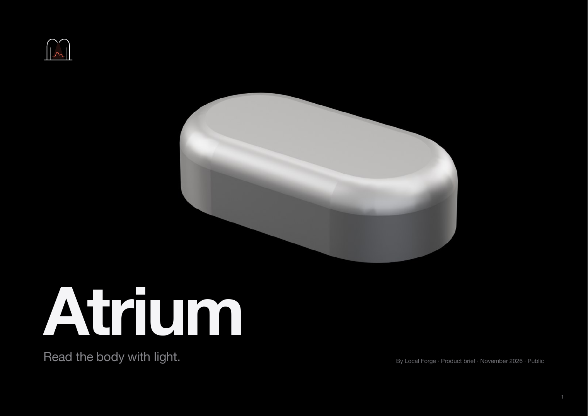

# Docs

  
   <a href="brochure/Atrium_Brochure.pdf">The Atrium brochure (PDF)</a>

| Document | What it covers |
|---|---|
| [quick-start.md](quick-start.md) | Try the app, open the files, build the firmware, order, flash and pair |
| [story.md](story.md) | How Atrium got from a 28 mm board to the EVT capsule |
| [architecture.md](architecture.md) | System, boards, power, radio, contacts |
| [mechanical.md](mechanical.md) | Shell, base, skin pad, Plinth, case, jig, packaging |
| [brain-blood-flow.md](brain-blood-flow.md) | Can a pod on the head see brain blood flow? The physics, the numbers and the tests |
| [research/brain-blood-flow/](research/brain-blood-flow/README.md) | The depth study behind it: report, hypotheses, protocol, figures and data |
| [placement.md](placement.md) | Where on the head the pod sits, and why |
| [charging-case.md](charging-case.md) | The case: charging, status, reset, firmware |
| [build-assembly-test.md](build-assembly-test.md) | Fabrication, assembly, bring-up and end-of-line tests |
| [flashing-and-test.md](flashing-and-test.md) | SWD pads, programming the pod and the case, production test |
| [FEATURES.md](FEATURES.md) | The numbered feature list shared by firmware and app |
| [ble_gatt.md](ble_gatt.md) | The Bluetooth interface between pod and phone |
| [open-items.md](open-items.md) | What is still open for EVT |
| [roadmap.md](roadmap.md) | EVT, DVT, the next version, and where help is wanted |
| [certification.md](certification.md) | OSHWA and regulatory notes |

Images used across the repository are in [`images/`](images/).

Documentation and images are licensed CC BY-SA 4.0 (see [`LICENSE`](LICENSE)). Copyright 2026 Het Bhavsar.
