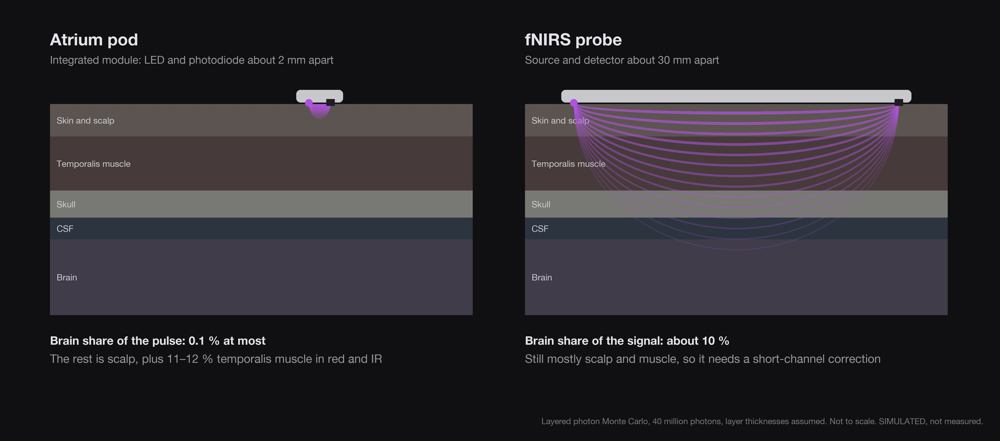
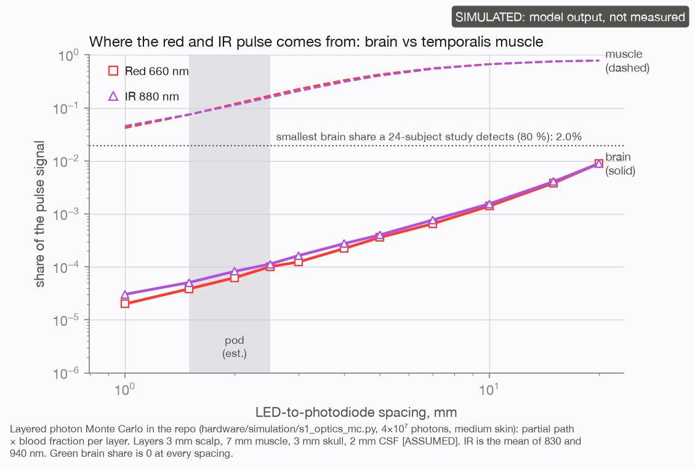
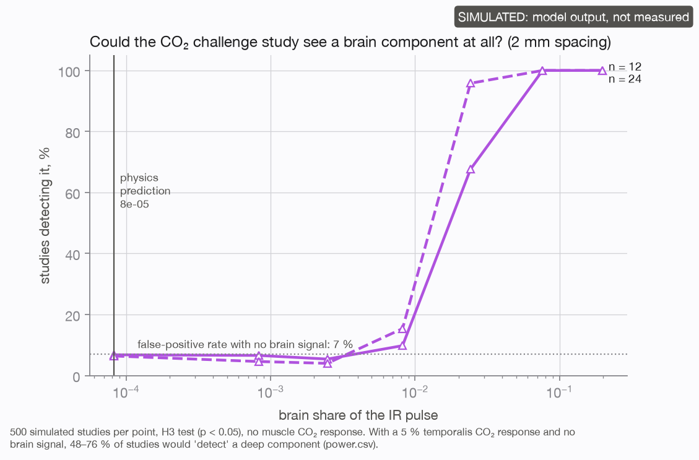
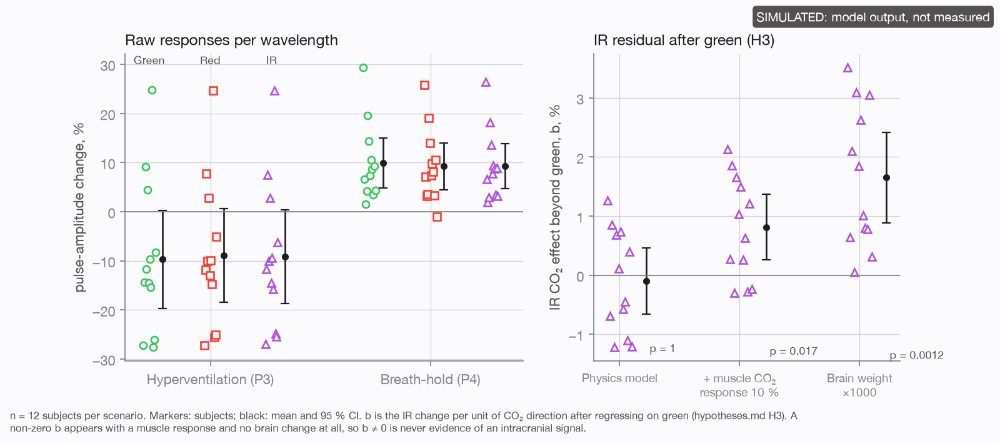

# Brain blood flow?

A pod on the side of your head sits little more than a centimetre from the brain. So the first question people ask me
is whether Atrium can see blood flow in the brain. I wanted that to be true, so before I promised anything I tried to
prove it. This page is what I found, written so you can check every step.

**Short answer: no.** A sensor this small reads the blood in your scalp. To reach the brain with light you need the
light source and the detector about 3 cm apart, and even then most of what you see is still scalp and muscle. Atrium
does not measure brain blood flow, and I won't claim it does.

  

## 1. How a light sensor reads blood

An optical sensor shines light into the skin and catches what scatters back. Blood absorbs light, so every heartbeat,
when the small vessels swell, a little less light comes back. That rhythm is the pulse.

The light that returns does not go straight down and up. It wanders through the tissue and comes back along a curved,
banana-shaped path between the LED and the photodiode. **How deep that banana reaches depends on how far apart they
are.** Put them close together and the light stays near the surface. Move them apart and the light that makes it across
has, on average, travelled deeper. Even at the 2–4 cm used for brain imaging, the signal is strongly weighted to the
outermost 10–15 mm inside the skull ([Strangman et al. 2013](https://doi.org/10.1371/journal.pone.0066319)).

The colour matters too. Green is absorbed quickly and stays in the top millimetre or two. Red and near-infrared go
further, which is why every brain-imaging optical system uses near-infrared.

## 2. What sits under the temporal region

From the skin inwards, at the spot where the pod sits:

| Layer | Thickness (used in our model) | Blood supply |
|---|---|---|
| Skin and scalp | 3 mm | Superficial temporal artery |
| Temporalis muscle (the jaw muscle) | 7 mm, and 5 mm in a thin-layer run. Measured by MRI at 3.7–17 mm between adults ([Surg Neurol Int](https://surgicalneurologyint.com/surgicalint-articles/standard-values-for-temporal-muscle-thickness-in-the-japanese-population-who-undergo-brain-check-up-by-magnetic-resonance-imaging/)) | Deep temporal arteries |
| Skull | 3 mm, and 2 mm in the thin-layer run [ASSUMED] | |
| Cerebrospinal fluid | 2 mm [ASSUMED] | |
| Brain | | Internal carotid and vertebral arteries |

Two things follow from this.

- **The pulse you feel at the side of your head is a scalp pulse.** The superficial temporal artery is a branch of the
  external carotid, which feeds the face and scalp, not the brain. Press just in front of your ear and you can feel it.
- **There is a muscle in the way.** The temporalis lies between the scalp and the skull. It has its own blood supply,
  it changes with chewing and clenching, and any light that goes deeper than the scalp passes through it first.

## 3. The two approaches we modelled

We simulated light travelling through these layers with a layered photon Monte Carlo (40 million photons per run,
green, red and infrared) and asked one question: what share of the pulse signal comes from each layer?

| | Atrium today | fNIRS |
|---|---|---|
| What it is | Optical heart-rate sensing (PPG): an integrated module with green, red and infrared LEDs and a photodiode in one 2.9 × 4.3 mm package | Functional near-infrared spectroscopy: near-infrared light, separate source and detector |
| Spacing | about 2 mm | about 30 mm |
| Green | more than 99.9 % scalp; brain 0 | not used |
| Red and infrared | 88–89 % scalp, 11–12 % temporalis muscle, **brain 0.006–0.008 %** | **brain about 10 %** (10.6 % in our model) |
| With the thinnest published layers | brain about 0.05 %, up to about 0.1 % with a 3.7 mm muscle | |
| Fits on the side of the head? | yes, it is the pod | needs a band or a 3 cm probe |

Our 30 mm result lands inside the 8–13 % that a published head-template simulation reports for 25–35 mm spacing
([Strangman et al. 2013](https://doi.org/10.1371/journal.pone.0066319)). That
agreement is why I trust the model at 2 mm too.

  
   Share of the red and infrared pulse from the brain (solid) and from the temporalis muscle (dashed) as the spacing grows. Simulated.

**The spacing is set by the part, not by us.** Atrium's sensor is an integrated optical module (MAXM86161A): the green,
red and infrared LEDs, the photodiode and the analog front end all sit in one 2.9 × 4.3 mm package. The distance from
emitter to diode is fixed inside that package at about 2 mm. No firmware, setting or algorithm can move it, so the
light can only ever sample the top few millimetres. The MAXM86161A keeps the MAXM86161 package, so the spacing is
the same; its brighter green LED gives a stronger skin signal, not a deeper one.

**We also tried a far detector.** The first design, Rev B.1, used separate LEDs and two photodiodes, one of them
18.5 mm away from the LEDs as a "far channel" to look deeper. The model showed what that buys: at about 20 mm the
brain's share is still only about 1 %, while the temporalis muscle is about three quarters of the red and infrared
pulse. It cost 8 mm of length for a signal dominated by the jaw muscle, so it was dropped
([`legacy/`](../legacy/README.md)).

## 4. Why better processing can't rescue it

The obvious reply is "the brain part is small, so filter harder". We tested that too.

- **The signal is hundreds of times too small to find.** I simulated the study I would actually run: people breathe
  extra CO₂, which widens brain vessels, and we look for a matching change in the pod's signal. To detect a brain
  share reliably (80 % of the time) we would need it to be about **3.8 % with 12 people, or 2 % with 24**. Physics gives
  0.008 % with typical layers, 0.05 % with thin ones and about 0.1 % with the thinnest muscle: **20 to 450 times too
  small**.
- **Faster sampling does not help.** At 200 samples a second instead of 25, the shortfall barely moves (from 454 to 360
  times). A perfect, noiseless sensor is still 346 times short (231 times with 24 people). The limit is the natural beat-to-beat change in scalp
  and muscle blood, which looks exactly like a deeper pulse would.
- **Machine learning can't find it either.** I trained three kinds of learned model, from a straight-line fit to a
  small neural network, on 300 simulated people to pull the brain part out of the green, red and infrared signals,
  then tested them on 150 others. At the brain share physics gives, none did better than guessing zero. They only
  start to work when the brain's share is raised 300 to 1000 times above physics, and even then they recover under a
  third of it. A model can only find what the light carries, and at 2 mm the light carries almost nothing from the
  brain. The MAXM86161A's brighter green does not change this: brighter is not deeper.
- **Muscle fools the test.** The temporalis also responds to CO₂. In simulation, a 5 % muscle response alone produced a
  false "deeper than skin" result in 48 % of 12-person studies and 76 % of 24-person studies, with no brain signal at
  all.
- **Timing differences prove nothing on their own.** Infrared arrives about 25 ms before green in a real finger
  recording (22 people, 500 samples a second, public data), and there is no brain in a finger.

So a deeper-looking number from a small sensor is far more likely to be muscle than brain.

## 5. What to ask any device that claims to see brain blood flow

These are the questions I asked myself. They are fair to ask of any product, including this one.

1. **How far apart are the light source and the detector?** Under about 2 cm, the brain's share is tiny. The physics
   does not care how good the algorithm is.
2. **Is there a short channel?** Serious fNIRS adds a second detector about 8 mm from the source that sees only the
   scalp, and subtracts it ([Brigadoi and Cooper 2015](https://doi.org/10.1117/1.NPh.2.2.025005)). Without one, scalp changes are reported as brain changes.
3. **What was it validated against, and in how many people?** Transcranial Doppler or MRI blood-flow imaging, in a
   published study, is the bar. A correlation with heart rate is not.
4. **Does the signal survive the controls?** If pressing the temporal artery in front of the ear wipes it out, it is
   scalp. If clenching the jaw changes it, it is muscle.
5. **Measured or simulated?** Say which. Every number on this page is simulated or from finger data, and is labelled
   that way.

## 6. Other ways to see brain blood flow, and whether the pod can use them

Light is not the only way in. I looked at every other non-invasive route I could find, and asked of each whether the
pod could do it, either as it is or with changes that still fit a 20.9 mm pod.

| Route | What it reads | What it needs | How much is brain | The pod as it is | A changed pod of this size |
|---|---|---|---|---|---|
| Light at 2 mm (Atrium today) | Pulse in the skin | LEDs and a photodiode in one module | 0.008–0.05 % | Scalp pulse only | No: the longest spacing that fits is about 18 mm, and Rev B.1's 18.5 mm gave about 1 % brain and 75 % jaw muscle |
| Light at 30 mm (fNIRS) | Oxygen change in the outer brain | Separate source and detector about 3 cm apart | About 10 %, outer 5–8 mm of the brain | No | No: needs a band or a larger probe |
| Laser speckle (diffuse correlation spectroscopy) | A blood-flow index from the flicker of laser light | A coherent laser and very fast photon counters or a camera, 2–3 cm apart | Some outer brain at that spacing | No | No: the same spacing problem, plus the laser |
| Head impedance (rheoencephalography) | The head's electrical impedance with each beat | A current source and electrodes spread across the head | Mostly scalp: over 60 % of the signal in one model, 8–12 % intracranial at most in another; in people, stopping scalp flow with a cuff left 12–68 % of it | No: the pod's two skin pads are its charging contacts, millimetres apart | No: the electrodes must span the head, and two pods would need a wire between them to carry the current |
| Ultrasound Doppler through the bone in front of the ear | Blood speed in the brain's main arteries | A 2 MHz ultrasound array with a high-voltage pulser, receiver and beam steering | The arteries themselves | No | Not practical: a 12 mm transducer would fit, but its electronics draw far more than a 30 mAh cell can give for long [ASSUMED], and it is a regulated medical device |

The only wearable here that reads brain blood flow is the ultrasound patch. A 2024 study fitted a conformal 2 MHz
patch at the bone window in front of the ear, where the pod also sits. It tracked the brain's main arteries with
mean differences of a few cm/s against a hospital probe in 36 healthy people, and recorded one person for 4 hours.
It found the vessel in 71 % of tries, against 75 % for the hospital probe. That is a separate device built for brain
blood flow, not something a light sensor can grow into.

I also looked for an Analog Devices design for brain blood flow, since the pod's module comes from them. I found none
published (searched 2026-11-10). Their optical front ends could drive a research fNIRS probe, but only with the 3 cm
spacing above.

**What the pod can honestly offer near this topic**, as wellness signals and never called brain blood flow:
- a scalp perfusion trend at the temporal region: the pulse of the superficial temporal artery, which feeds the scalp;
- the things that drive brain blood flow, without measuring it: breathing rate (carbon dioxide is the main lever),
  posture changes such as standing up, and the heart's response.

## 7. What we will test next

Nothing above is a head measurement yet. These are the experiments, with the smallest number of people that can give
a clear answer:

| Test | What it shows | People |
|---|---|---|
| Press the temporal artery during recording | If every colour collapses, the pulse is scalp | 10 |
| Breathe CO₂, with a capnometer, chest ECG and finger reference | Whether anything deeper than scalp responds, with muscle controls | 24 |
| Ultrasound at the pod spot | Real layer thicknesses, so the model fits each person | 5 |
| A two-distance research probe (8 mm and 30–35 mm) with transcranial Doppler | The only route to a real brain comparison. A research tool, not the pod | 20 |

We will publish the results here, including the negative ones.

## 8. What Atrium is

A wellness device that reads your pulse, heart-rate variability, skin-temperature trend, sleep and activity from the
scalp, very well, in a pod small enough to forget. That is a lot, and I would rather do it honestly than promise
something the physics can't give.

— Het

## The full study

Everything on this page comes from a pre-registered depth study. Its report, hypotheses, protocol, seven figures and
all result data (photon model output, 500-study power sweeps, simulated studies and the finger timing) are in
[`research/brain-blood-flow/`](research/brain-blood-flow/README.md). Check our numbers there.

  
  
   Left: how large a brain share a 12- or 24-person study could detect. Right: a muscle-only response passing as "deep". Both simulated.

## Sources and method

- **Photon model:** layered Monte Carlo, 4 × 10⁷ photons, medium skin; layers 3 mm scalp, 7 mm or 5 mm temporalis,
  3 mm or 2 mm skull, 2 mm CSF [ASSUMED for any one person]. Output for the earlier sensor layout is in
  [`legacy/rev-b1/hardware/simulation/results/`](../legacy/rev-b1/hardware/simulation/results/).
- **Study power:** 500 simulated studies per point, with the analysis fixed before any data was looked at.
- **Learned unmixing:** ridge regression, gradient boosting and a two-layer neural network on the study's simulator,
  300 simulated people to train and 150 to test, at the physical brain share and up to 10,000 times it
  ([`data/ml_unmix/`](research/brain-blood-flow/data/ml_unmix/unmix.json)). SIMULATED.
- **Finger timing:** pulse-transit-time-ppg 1.1.0 (PhysioNet, ODbL 1.0), 22 people, sitting, 500 Hz.
- **Published work:**
  - Strangman, Li and Zhang (2013), *PLoS ONE* 8(8): e66319: brain sensitivity of 8–13 % at 25–35 mm on the Colin27
    head template, and the bias towards the outer 10–15 mm.
  - Brigadoi and Cooper (2015), *Neurophotonics* 2(2): 025005: the 8.4 mm optimum short-channel distance in adults.
  - Temporal muscle thickness by MRI, 360 adults aged 35–84: 3.69–16.90 mm (*Surgical Neurology International*).
  - The superficial temporal artery is a terminal branch of the external carotid artery (standard anatomy).
  - Zhou et al. (2024), *Nature* 629: 810–818: a conformal ultrasound patch for continuous 3D monitoring of
    cerebral blood flow; 36 healthy volunteers against a hospital probe, one 4-hour recording
    ([PDF](https://xugroup.eng.ucsd.edu/wp-content/uploads/2024/11/92_Nature.pdf)).
  - Rheoencephalography and scalp blood flow: a clinical cuff study
    ([PMC4169836](https://www.ncbi.nlm.nih.gov/pmc/articles/PMC4169836/)) and a finite-element model
    ([BioMedical Engineering OnLine 13:131](https://biomedical-engineering-online.biomedcentral.com/articles/10.1186/1475-925X-13-131)), and the scalp-thickness study on electrode layouts
    ([INIS](https://inis.iaea.org/records/0a91c-tpm04)).
  - Real-time diffuse correlation spectroscopy for cerebral blood flow with on-chip correlators
    ([arXiv 2503.17459](https://arxiv.org/abs/2503.17459v2)).
- **Not yet cited:** the skull and CSF thicknesses are model assumptions.
- **Status:** no Atrium head recording exists yet. Every result here is simulated or from finger data.
