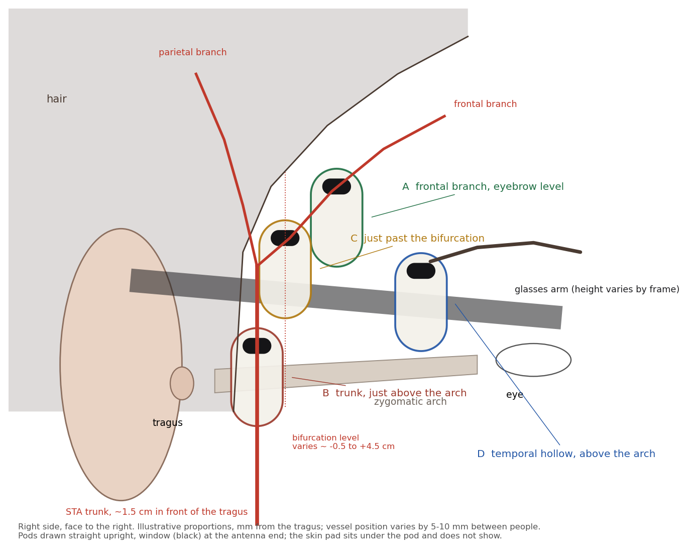

# Placement on the head

Where the upright pod sits on the temporal region so its optical window lands on a good pulse, with the anatomy behind the choice and the fit guide the app uses.

The pod is worn upright: long axis straight up and down (no tilt), antenna end up (see [mechanical.md](mechanical.md#wear-orientation)). The optical window is at that same top end, 6.7 mm above the pod's centre and 3.8 mm from its top tip.

The figure uses illustrative adult proportions, in mm from the tragus, and the pod's real outline and window. It checks each position against a glasses arm and the hairline.

## The artery

What the sources agree on, and how much it varies:

- **Trunk.** The superficial temporal artery rises just in front of the ear and crosses the zygomatic arch.
  - Its distance in front of the tragus is about **15.5 ± 4.5 mm** (CT, 57 people, on an eye–tragus line), and 16.7 mm in one cadaver series.
  - At the arch its diameter is about **2.7 mm** (cadaver).
  - This is where its pulse is easiest to feel.
- **Bifurcation.** It is above the arch in about **79 %** of people (pooled cadaver data; single-series range 60–90 %), and at or below the arch in the rest.
  - The figure draws 2–3 cm above the arch as typical. The bifurcation level is the most variable thing in this study [VERIFY on people].
- **Frontal branch.** It runs forward and up, about **45°** on average (CT).
  - It is small: about **0.9–1.1 mm** across (CT and flap series).
  - It is shallow: about **2.1 ± 0.8 mm** under the skin near the brow (CT).
  - Its course is called "high" or "low" type, depending on whether the bifurcation is above or below the brow line.
- **Parietal branch.** It runs up and back into the hair.
- **Depth trend.** The artery gets shallower and smaller from the trunk to the branches.

## The optics

- The MAXM86161 has green (≈ 527 nm), red (660 nm) and IR (880 nm) LEDs and one photodiode in a 2.9 × 4.3 mm module.
- The LED-to-photodiode spacing isn't in the datasheet text: ≈ 1.5–2.5 mm, from the package size [VERIFY on the package drawing].
- In reflection PPG, light samples to roughly half to one source–detector spacing deep, and deeper for red and IR than for green [VERIFY against a tissue-optics source].
  - **Green:** reaches about the upper 1 mm of skin (the dermal capillary bed). It gives the heart rate wherever the skin is well perfused, on or off the artery.
  - **Red / IR:** reach about 1.5–3 mm. That is the depth of the frontal branch (2.1 ± 0.8 mm), so a window over the branch adds pulsatile signal to the relative SpO₂ trend channels.
  - **Trunk:** deeper and under a thicker layer near the arch. The pulse there is strong to the finger, but the optics see mostly the skin above it.
- **Conclusion:** being near the artery helps signal amplitude and motion robustness, but it isn't all-or-nothing. A good dermal signal anywhere on the upper temporal region carries HR and HRV. Being right over a vessel matters most for the red / IR channels.

## Positions

| | **D: temporal hollow, just above the arch** | **A: frontal branch, about eyebrow level** | **B: trunk, just above the arch** | **C: just past the bifurcation** |
|---|---|---|---|---|
| Window target (from the tragus) | ~50 mm forward, ~24 mm up: in the temporal hollow, lateral to the outer orbital rim | ~32 mm forward, ~42 mm up | ~15 mm forward, ~8 mm up | ~21 mm forward, ~31 mm up |
| Vessels under the window | Branches of the artery: frontal-branch twigs and the zygomatico-orbital artery along the arch [VERIFY on people] | Frontal branch, ~1 mm, ~2 mm deep: within red / IR reach | Trunk, ~2.7 mm, deepest: green sees only the skin above it | The largest shallow segment |
| Anatomical basis | The anterior temporal region lies over the artery's branches (Pinar and Govsa 2006) | Anatomy only | Anatomy only | Anatomy only |
| Glasses arm (figure) | **Crosses the pod**: the hollow is where the arm runs | **Clear by 4.2 mm**: the arm passes under the pod | Clear by 5.3 mm (pod below the arm) | **Crosses the pod** |
| Hair | Bare skin, well clear of the hairline | Bare skin in front of the hairline | **On the sideburn**: the adhesive won't hold on hair, and hair scatters light | Bare, at the edge of the hairline |
| Jaw and chewing | Over the front of the temporalis: a hard bite moves it [VERIFY with a chewing test] | Over the front of the temporalis; moves a little | The pod hangs below the arch, near the jaw joint (TMJ): moves with every bite | Over the temporalis; less movement than B |
| Sweat, comfort, visibility | Facial skin, flat hollow; **most visible** | Forehead-side sweat; comfortable; visible | Hidden by hair; pressure on the arch | Partly behind the glasses arm |
| If the vessel is 5–10 mm off | Forgiving: the site relies on the dermal bed fed by several small branches, not on one vessel | **Least forgiving**: the branch is thin and its path varies | Most forgiving side to side (trunk ±4.5 mm) | Medium |

**Flipping the pod (window down)** is rejected for every position. It puts the antenna next to the glasses arm and hinge (worst with metal frames) and near the jaw.

## Recommendation

**Without glasses: position D.**
- Straight upright, long axis vertical, antenna and window at the top.
- The window goes in the temporal hollow: above the zygomatic arch and just behind the outer edge of the eye socket. The pod's bottom end sits just above the arch.
- It is bare skin and flat, and it doesn't depend on hitting one thin vessel.

**With glasses: position A.**
- At D the glasses arm crosses the pod, so move the pod up until the arm passes under it, which puts the window over the frontal branch at about eyebrow level.
- A is less forgiving, so the live signal bar matters more there.

**C** is an in-between fallback for people without glasses whose signal at D is weak.

**Avoid B:** it sits on hair, over the jaw joint, and on the thickest tissue.

**The fit screen** in the app asks "Do you wear glasses?" and shows D or A. Both use the live signal-quality bar for the last few millimetres. The steps are the same on the left and right temporal regions.

**What would change this:** real glasses-arm heights, hairlines and pulse spots measured on 10–20 people in EVT, including a chewing test at D. The figure's proportions are illustrative [VERIFY on people].

## Fit guide

For the app's onboarding fit screen.

**No glasses (D):**
1. Find your temporal hollow: the soft hollow just above your cheekbone, about a thumb-width behind the outer corner of your eye.
2. Place the pod upright there, with its top end in the hollow. The bottom end should sit just above the cheekbone.
3. Hold still and watch the signal bar. Slide a few millimetres until it turns green, then press for 10 seconds.

**With glasses (A):**
1. Put your glasses on and find where the arm crosses the side of your head.
2. Place the pod upright just above the arm, with its top end at about eyebrow level on bare skin in front of your hairline. The arm should pass just under the pod.
3. Hold still and watch the signal bar. Slide a few millimetres until it turns green, then press for 10 seconds.

## Sources

- [Superficial temporal artery: anatomical variations in course, branching, depth and anastomoses, systematic review (J Craniofac Surg)](https://www.citedrive.com/en/discovery/the-superficial-temporal-artery-anatomical-variations-in-course-branching-patterns-depth-relationships-and-anastomotic-networksa-systematic-review-of-cadaveric-and-imaging-evidence/)
- [Anatomic bases of the superficial temporal artery and the temporal branch of the facial nerve (Turk Neurosurg)](https://www.turkishneurosurgery.org.tr/pdf.php?id=2764)
- Pinar YA, Govsa F. [Anatomy of the superficial temporal artery and its branches: its importance for surgery](https://acikerisim.ege.edu.tr/items/d3e5ce8d-7da8-47e7-a8fa-0f7aa63162e8/full). Surg Radiol Anat 2006;28(3):248–253.
- [Superficial temporal artery anatomy, Egyptian Journal of Anatomy (2018)](https://dx.doi.org/10.21608/ejana.2018.43501)
- [CT-angiography study of the frontal branch (Hacettepe thesis)](https://openaccess.hacettepe.edu.tr/bitstreams/7917b0ca-c33c-4617-be4b-9766bdd0eace/download)
- [Anatomical variant of the STA in temporoparietal fascia flaps for microtia](https://bvbvf1.bib-bvb.de/vufind/PrimoRecord/cdi_proquest_miscellaneous_2932936955)
- [MAXM86161 data sheet (Analog Devices)](https://www.analog.com/MAXM86161/datasheet): LED wavelengths; package 2.9 × 4.3 × 1.4 mm
