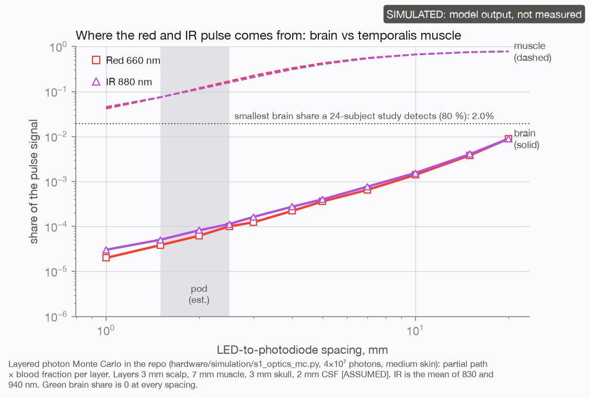
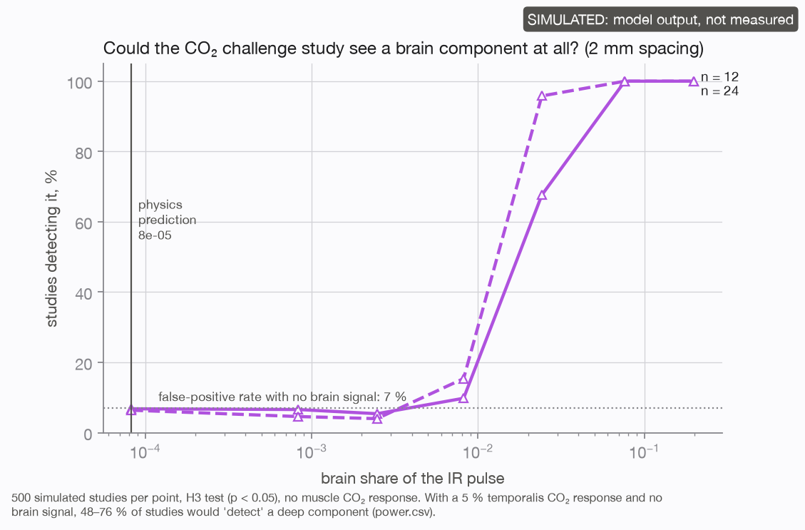
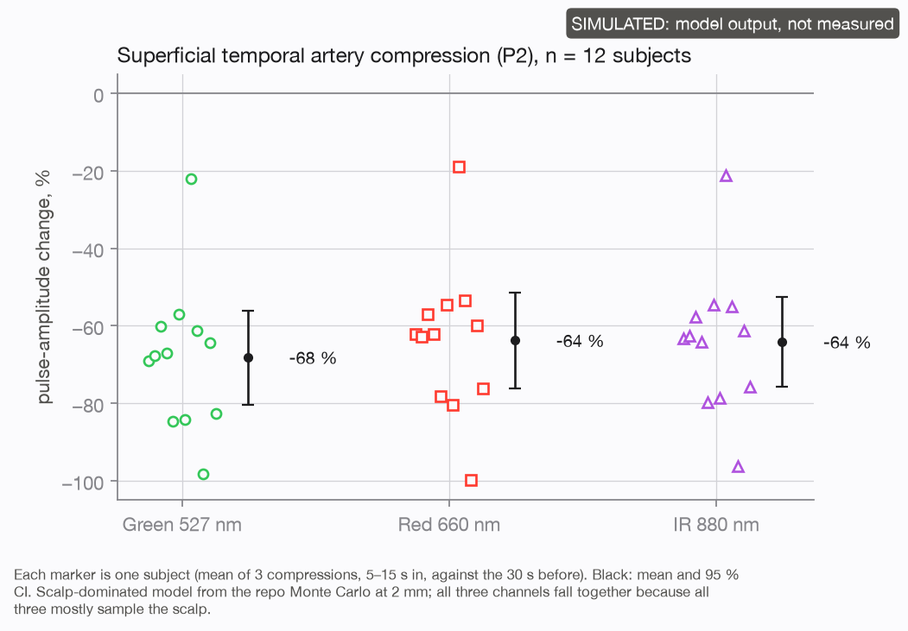
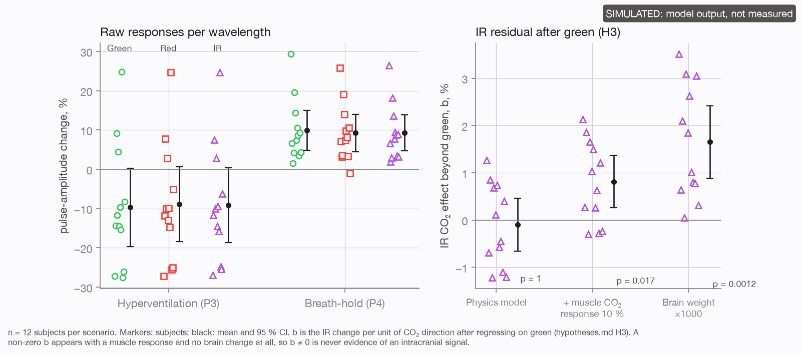
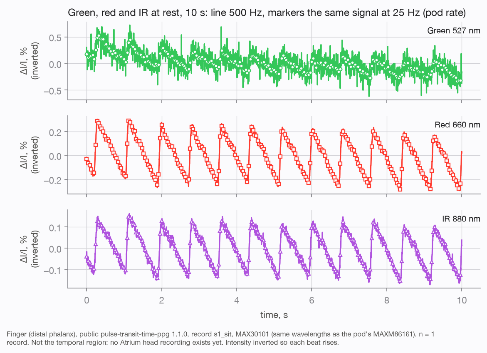
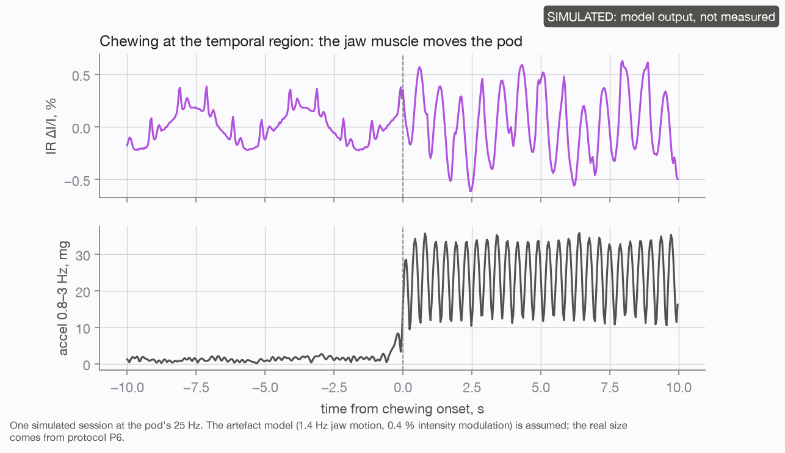
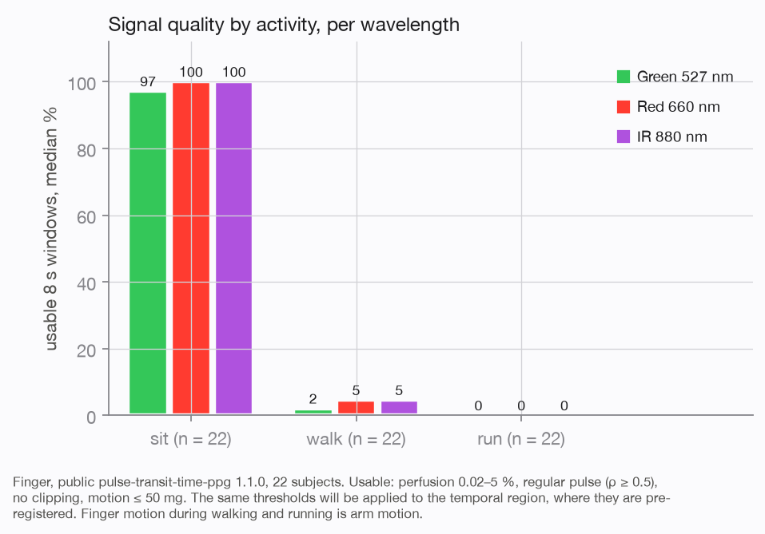

# Depth study: does the pod's signal contain anything from the brain?

This is the study behind [Brain blood flow?](../../brain-blood-flow.md). It asks how much of the pod's green, red and
infrared signal comes from the scalp, how much from the temporalis muscle, and whether anything measurable comes from
the brain. The hypotheses were written down and time-stamped before any analysis ran, and a negative answer counts as
an answer.

**Status:** no Atrium head recording exists yet. The results rest on a photon model, simulated studies with known
answers, and real finger recordings from a public dataset. Every simulated output is labelled SIMULATED.

## The answer

| Question | Answer | Evidence |
|---|---|---|
| Where does the pod's pulse come from? | Scalp. Green: more than 99.9 % scalp. Red and IR: 88–89 % scalp, 11–12 % temporalis muscle | Photon model, `data/monte_carlo/` |
| How much is brain? | 0.006–0.008 % with typical layers; about 0.05 % with the thinnest published layers, up to about 0.1 % with a 3.7 mm muscle | Photon model, `figures/f6_depth.png` |
| How much at fNIRS spacing? | 10.6 % at 30 mm, inside the 8–13 % that published head models give at 25–35 mm | Photon model |
| Could a study on the pod detect it? | No. 80 % power needs a brain share of 3.8 % (12 people) or 2.0 % (24 people): 20–450 times more than physics gives | 500 simulated studies per point, `data/power/`, `figures/f7_power.png` |
| Does sampling faster help? | Barely. 25 → 200 Hz moves the shortfall from 454× to 360× (12 people); a noiseless sensor is still 346× short | `data/research_mode/` |
| Can a "deeper than green" result be trusted? | No. A 5 % temporalis response alone gives a false deep result in 48 % (12 people) to 76 % (24 people) of studies | `data/sim_muscle/`, `figures/f3_co2_challenges.png` |
| Is an IR–green timing lag depth evidence? | No. In real finger data IR leads green by a median 25 ms (IQR 16–36 ms, 21 of 22 people), and a finger has no brain | `data/finger/` |
| Does the analysis find the right answer when it is known? | Yes, after two method faults were found and fixed. Null study: nothing found (b = −0.1 % [−0.7, +0.5]); false-positive rate 7 % over 2,000 studies | `data/sim_null/`, `data/sim_deep1000/` |

## Figures

  
  

  
  

  
  
  

| Figure | Shows |
|---|---|
| `f1_raw_traces.png` | What the three colours look like, raw |
| `f2_sta_compression.png` | Pressing the temporal artery: how far each colour's pulse falls (the scalp test) |
| `f3_co2_challenges.png` | The CO₂ test in three simulated worlds: no deep signal, muscle only, and an exaggerated deep signal |
| `f4_chewing.png` | Chewing, talking and clenching, and how they show up |
| `f5_quality.png` | Signal-quality screening |
| `f6_depth.png` | Brain and muscle share of the pulse as the LED-to-photodiode spacing grows |
| `f7_power.png` | How big a brain share a study of 12 or 24 people could detect |

## Write-ups

| File | What it is |
|---|---|
| [`report.md`](report.md) | What we can claim, what we cannot, what would change our mind, and the next experiments |
| [`hypotheses.md`](hypotheses.md) | The pre-registered hypotheses, windows, exclusions and tests |
| [`protocol.md`](protocol.md) | The recording protocol P1–P8, safety and stop rules, reference devices |
| [`data_inventory.md`](data_inventory.md) | What data exists and what the firmware can and cannot give yet |
| [`research_mode.md`](research_mode.md) | What faster sampling adds (pulse timing) and what it cannot (depth) |

## Data

| Folder | Contents |
|---|---|
| `data/monte_carlo/` | Photon model output per layer and spacing: `s1_mc.json` (scalp 3 mm, muscle 7 mm, skull 3 mm) and `s1_mc_thin.json` (muscle 5 mm, skull 2 mm) |
| `data/power/` | Detection rate against spacing, brain share, muscle response and number of people (CSV and JSON) |
| `data/research_mode/` | The same at 25, 50, 100 and 200 Hz, and for a noiseless sensor |
| `data/sim_null/`, `data/sim_muscle/`, `data/sim_deep1000/` | Full simulated studies: per-session and per-subject results and the study verdict. SIMULATED |
| `data/finger/` | Per-record timing on real finger PPG |

**Session format** for future head recordings: one folder per session with a `session.json` (subject, session, site,
sample rate, protocol events on the PPG time base, reference devices, a `simulated` flag) and a `signals.npz` holding
`green`, `red`, `ir` raw counts, the pod-frame accelerometer in g, and optional ambient and ECG R-peak times.

## Rules this study follows

- No brain, cerebral or intracranial measurement claims, and no medical claims.
- Outputs are relative optical indices: scalp-dominated, not validated against transcranial Doppler or MRI.
- Anything beyond green is "consistent with", never "measures".
- Simulated results are labelled in every output and never reported as findings about tissue.

## Credits

Finger timing uses *pulse-transit-time-ppg* 1.1.0 from PhysioNet, under the Open Database Licence 1.0. The files in
`data/finger/` are results computed from it, not the recordings themselves.
