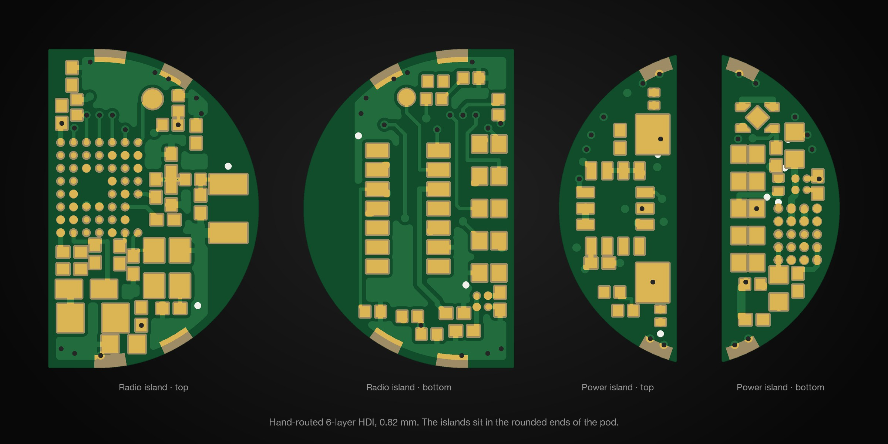
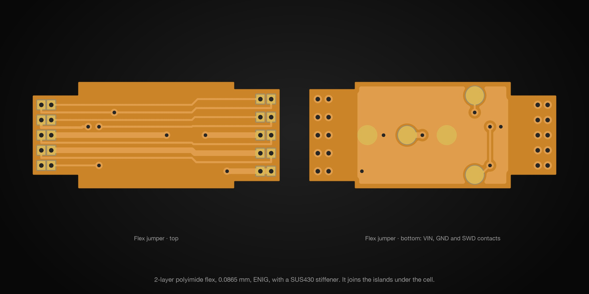
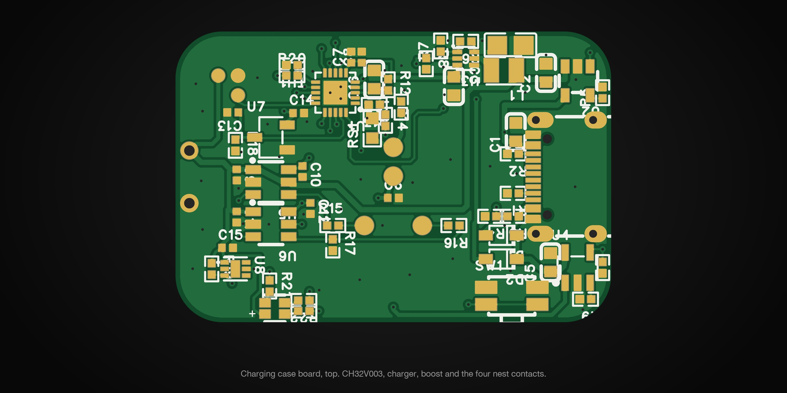
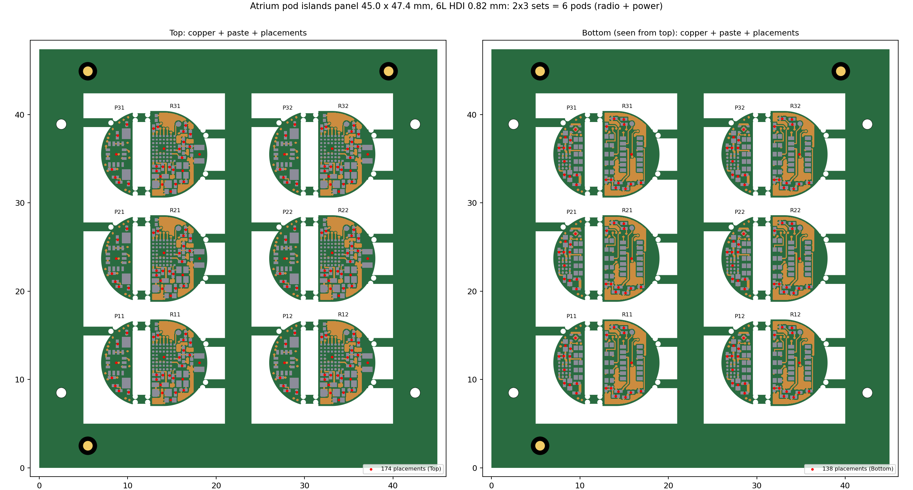
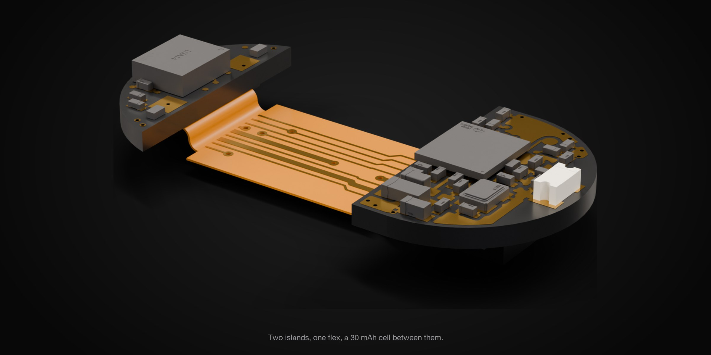
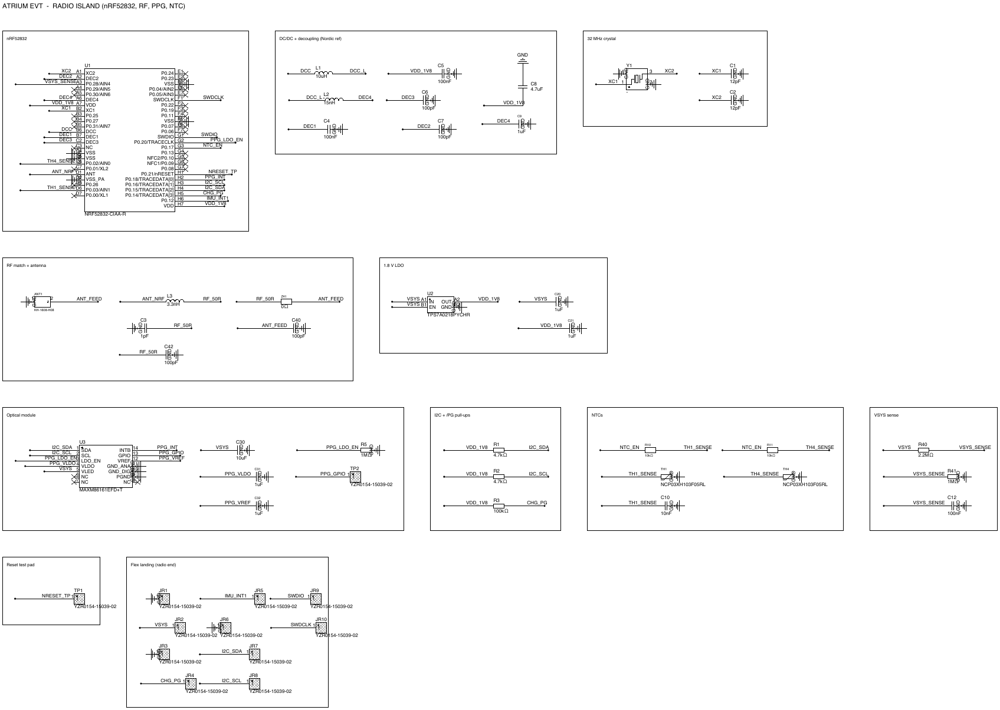
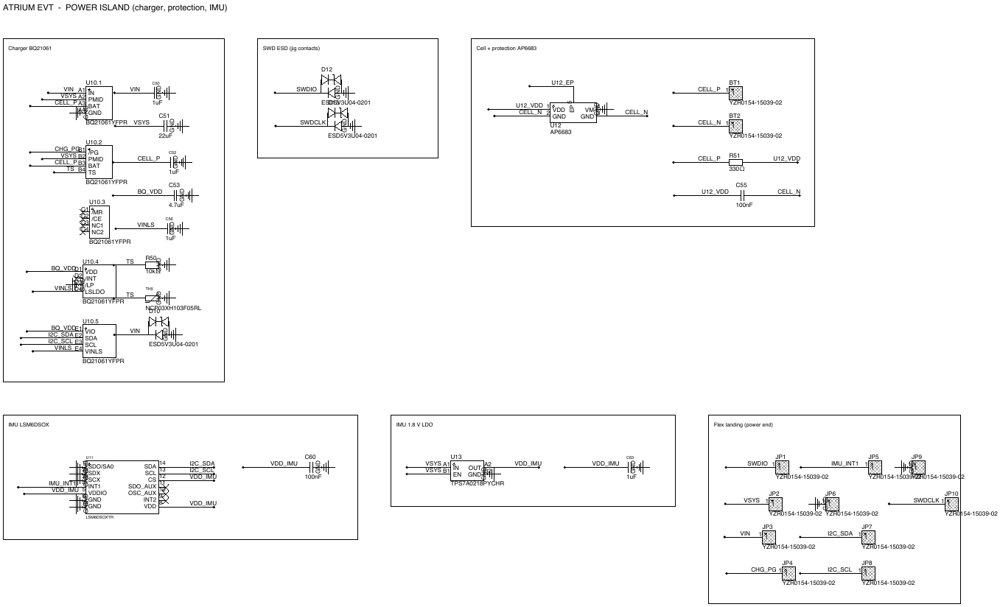
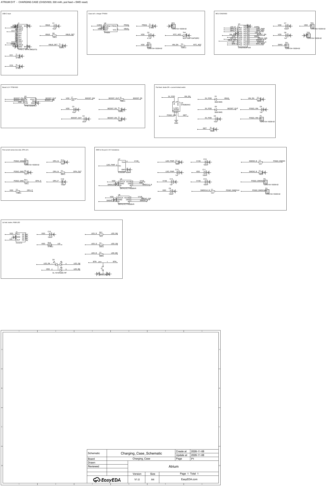

# Hardware

Every board of the Atrium EVT build: the two pod islands, the flex that joins them, a panel of both islands for
ordering, and the charging-case board. All dimensions are in mm.

  

  

  

  
   The islands panel: six pods, 312 placements, one order.

  

| Board | Build | Folder |
|---|---|---|
| Radio island | 6-layer HDI 1+4+1, 0.82 mm, JLC06081H-2313, ENIG. nRF52832 WLCSP, MAXM86161, chip antenna | `pod/radio-island/` |
| Power island | Same stack. BQ21061 charger, AP6683 protection, LSM6DSOX, 1.8 V LDO | `pod/power-island/` |
| Flex jumper | 2-layer polyimide, 0.0865 mm, ENIG both sides, SUS430 stiffener; no parts | `pod/flex-jumper/` |
| Islands panel | Both islands, 2 × 3 sets, tabs and mouse bites, for one PCB and PCBA order | `pod/islands-panel/` |
| Charging case | 2-layer FR-4, 0.8 mm. CH32V003, TP4054, TPS61023 boost, SY6280 limit, USB-C | `case/charging-case/` |

Each board folder has the same three parts:

| Folder | Files |
|---|---|
| `schematic/` | `.SchDoc` (Altium format), PDF, SVG |
| `pcb/` | `.PcbDoc` (Altium format), a PDF with every layer, the 3D model (STEP) and top and bottom renders |
| `production/` | Gerbers and drills (zip), BOM and pick-and-place (CSV, LCSC part numbers), IPC-D-356A netlist |

The `.SchDoc` and `.PcbDoc` files are exported from EasyEDA Pro. They open in Altium Designer, and KiCad imports them
(File → Import Non-KiCad Project). The PDFs, Gerbers and CSVs need no EDA tool.

Also here:

| Path | Contents |
|---|---|
| `design-data/netlist/` | The logical netlists the schematics were captured from (YAML) |
| `design-data/pinmap/` | nRF52832 pin map, shared with the firmware board files |
| `design-data/constraints/` | PCB rules (stack, impedance, RF, EMC) and flex rules |
| `design-data/outline/` | Board outlines and keep-outs (DXF, SVG) |
| `simulation/` | Simulation reports and plots: RF chain, CPWG impedance, link budget, optics, power, charging tolerance, thermal, assembly |
| `stencil-report.md` | Stencil area ratios for every board |
| `easyeda/` | The native EasyEDA Pro project with every board, the editable source of all of the above |

## Schematics at a glance

Every schematic is drawn in titled functional blocks with net labels. Full sheets are in each board's `schematic/`
folder (PDF, SVG and SchDoc).

  
   Radio island: nRF52832, DC/DC, crystal, RF match and antenna, LDO, optical module, NTCs, flex landing.

  
   Power island: charger, cell protection, motion sensor and the 1.8 V LDO.

  
   Charging case: MCU, charger, boost, current limit, SWD translators and the pod nest.

## Ordering

- **Pod:** order the islands panel (`pod/islands-panel/`, read its order notes) and the flex jumper. The flex has no
  parts, so it needs no assembly.
- **Case:** order `case/charging-case/production/` as a one-sided PCBA with a 0.10 mm stencil.
- Build, flash and test steps are in [`docs/build-assembly-test.md`](../docs/build-assembly-test.md).

## Checks

- Every board was routed by hand. EasyEDA DRC: radio and power islands 0 errors; panel 0 errors. Charging case: two
  items inside the USB-C footprint (the maker's land pattern, accepted). Flex: two "connection" notes at the power end:
  JP6 is joined to ground by the power island's copper when soldered (by design), and JP9's via-in-pad is counted
  open by DRC although the Gerbers show it joined to the ground pour.
- Paste apertures were checked per pad for area ratio and the fine-pitch ones enlarged in the released paste layers.

## Licence

Copyright 2026 Local Forge.

This source describes Open Hardware and is licensed under the CERN-OHL-S v2.

You may redistribute and modify this source and make products using it under the terms of the CERN-OHL-S v2
(<https://ohwr.org/cern_ohl_s_v2.txt>). This source is distributed WITHOUT ANY EXPRESS OR IMPLIED WARRANTY,
INCLUDING OF MERCHANTABILITY, SATISFACTORY QUALITY AND FITNESS FOR A PARTICULAR PURPOSE. Please see the CERN-OHL-S
v2 for applicable conditions.

Source location: <https://github.com/Het-Bhavsar/Atrium>

As per CERN-OHL-S v2 section 4, should you produce hardware based on this source, you must where practicable maintain
the Source Location visible on the external case of the Atrium pod or case, or other products you make using this
source.

Full licence text: [`LICENSE`](../LICENSE).
