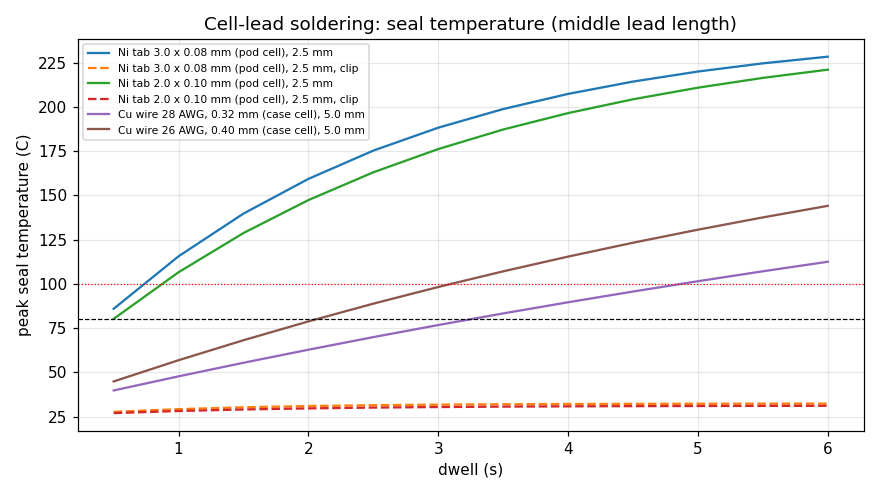

# Assembly process checks

Estimates for planning the EVT build; measure on the first boards.

## 1. Cell-lead soldering: peak temperature at the pouch seal

Joint held at 250 C for the dwell (iron 330-350 C), then left to cool; lead side loses heat to air (h 25 W/m^2K). Target <= 80 C at the seal, limit 100 C [VERIFY cell data sheet].

| Lead | Joint to seal (mm) | Case | 1 s | 2 s | 3 s | 5 s | Max dwell for <= 80 C |
|---|---|---|---|---|---|---|---|
| Ni tab 3.0 x 0.08 mm (pod cell) | 1.5 | bare | 149 | 199 | 224 | 242 | 0.2 s |
| Ni tab 3.0 x 0.08 mm (pod cell) | 2.5 | bare | 116 | 159 | 188 | 220 | 0.4 s |
| Ni tab 3.0 x 0.08 mm (pod cell) | 2.5 | seal C x5 | 49 | 65 | 80 | 106 | 3.0 s |
| Ni tab 3.0 x 0.08 mm (pod cell) | 2.5 | clip 0.5 W/K | 29 | 31 | 32 | 32 | 8.0 s+ |
| Ni tab 3.0 x 0.08 mm (pod cell) | 3.5 | bare | 98 | 134 | 161 | 196 | 0.6 s |
| Ni tab 2.0 x 0.10 mm (pod cell) | 1.5 | bare | 137 | 186 | 214 | 238 | 0.3 s |
| Ni tab 2.0 x 0.10 mm (pod cell) | 2.5 | bare | 107 | 147 | 176 | 211 | 0.5 s |
| Ni tab 2.0 x 0.10 mm (pod cell) | 2.5 | seal C x5 | 46 | 60 | 72 | 96 | 3.6 s |
| Ni tab 2.0 x 0.10 mm (pod cell) | 2.5 | clip 0.5 W/K | 28 | 30 | 30 | 31 | 8.0 s+ |
| Ni tab 2.0 x 0.10 mm (pod cell) | 3.5 | bare | 91 | 124 | 150 | 185 | 0.7 s |
| Cu wire 28 AWG, 0.32 mm (case cell) | 3.0 | bare | 58 | 81 | 102 | 136 | 1.9 s |
| Cu wire 28 AWG, 0.32 mm (case cell) | 5.0 | bare | 48 | 63 | 77 | 102 | 3.2 s |
| Cu wire 28 AWG, 0.32 mm (case cell) | 5.0 | seal C x5 | 30 | 33 | 37 | 43 | 8.0 s+ |
| Cu wire 28 AWG, 0.32 mm (case cell) | 5.0 | clip 0.5 W/K | 26 | 27 | 27 | 28 | 8.0 s+ |
| Cu wire 28 AWG, 0.32 mm (case cell) | 10.0 | bare | 40 | 48 | 56 | 70 | 6.6 s |
| Cu wire 26 AWG, 0.40 mm (case cell) | 3.0 | bare | 72 | 104 | 131 | 171 | 1.2 s |
| Cu wire 26 AWG, 0.40 mm (case cell) | 5.0 | bare | 57 | 79 | 98 | 131 | 2.1 s |
| Cu wire 26 AWG, 0.40 mm (case cell) | 5.0 | seal C x5 | 32 | 37 | 42 | 52 | 8.0 s+ |
| Cu wire 26 AWG, 0.40 mm (case cell) | 5.0 | clip 0.5 W/K | 27 | 28 | 29 | 31 | 8.0 s+ |
| Cu wire 26 AWG, 0.40 mm (case cell) | 10.0 | bare | 46 | 57 | 68 | 88 | 4.1 s |

Reading it:
- **The pod cell is the risky joint.** A bare nickel tab soldered 1.5-3.5 mm from the seal passes 80 C at the seal within about 0.2-0.7 s if the joint is held at 250 C, because the tab is short and the 30 mAh cell has little mass near the seal. Even if heat spreads into the electrode stack (seal C x5), the budget is only about 3 s at 2.5 mm.
- **What makes it safe:** a copper clip (or flat tweezers) on the tab between the joint and the seal takes the dwell to several seconds. So: tin the island pad first, tin the tab, use flux, clip the tab, then one touch of <= 1 s with a fine tip at 330 C; let it cool before a second touch. Better still, order the cell with a nickel extension tab or short wire leads welded on, so the joint sits 5 mm or more from the seal.
- **The case cell (copper wire at 3-10 mm):** 2-3 s per joint at 5 mm is within the target; pre-tin the wire. A pack with leads normally has its protection board between the wire and the cell, which adds margin.
- Never solder at the point where a tab leaves the seal, never reflow a cell, and fit cells after all reflow, cleaning and conformal steps.
- The model holds the joint at 250 C for the whole dwell and puts a small lumped heat capacity at the seal, so it is pessimistic; measure on a dummy cell with a 0.1 mm thermocouple at the seal before the first real build.

## 2. Bottom-side parts in the second reflow (upside down)

Rule of thumb: part mass / wetted pad area <= 30 g/in^2 (molten SAC305 surface tension).

| Part | Mass (mg, est.) | Pad area (mm^2) | g/in^2 | Verdict |
|---|---|---|---|---|
| U3 MAXM86161 (radio bottom, OLGA-14) | 38.4 | 3.70 | 6.7 | stays |
| U10 BQ21061 (power bottom, DSBGA-20) | 3.7 | 0.63 | 3.8 | stays |
| U12 AP6683 (power bottom, DFN-4 1x1) | 1.1 | 0.32 | 2.2 | stays |
| U13 DSBGA-4 (power bottom) | 0.4 | 0.08 | 3.2 | stays |
| U2 TPS7A02 (radio bottom, DSBGA-4) | 0.4 | 0.08 | 3.2 | stays |
| 0201 passive | 0.2 | 0.17 | 0.8 | stays |

All bottom-side parts are light against their pad area, so the islands can go through reflow twice without glue dots. Put the side with the WLCSP / DSBGA / MAXM86161 through reflow last if the assembler prefers fine-pitch parts on the second pass [ask JLC], but retention is not the limit either way.

