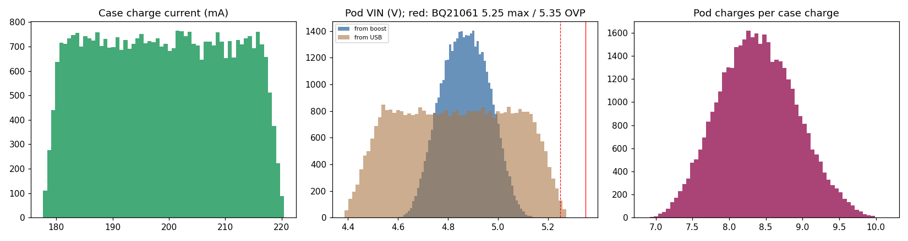

# Charging chain: tolerances, limits and charge times

40000 Monte Carlo draws, uniform over each datasheet min-max or tolerance band; percentiles 0.5 / 50 / 99.5.

## Case, Rev B: BQ24040 (R5 = 2.7 k)

Rev B (2026-11-10) replaces the TP4054 with the BQ24040, which adds a cell-temperature (TS) input. Worked by hand from
the data sheet (SLUS941H), not re-run through the Monte Carlo:

- **Charge current: 200 mA** (187-210 mA): I = K_ISET / R_ISET, K_ISET 510-560 AΩ (540 typ), R5 2.7 k ±1 %. 0.4 C on the 500 mAh cell.
- Termination at 10 % and pre-charge at 20 % of the set current (R24 2 k on PRE-TERM).
- **Heat:** at the start of constant current the BQ24040 drops (5.0 - 3.4 V) x 0.2 A ≈ 0.32 W, close to the
  TP4054 case below; its thermal pad goes to the ground pour. Measure with a thermocouple on U2 (build item B-10).
- **Case cell, flat to full:** about 2.6-3 h [EST].

## Case, Rev A (history): TP4054 (R5 = 4.7 k)

- **Charge current: 199 mA** (179-219 mA). The maker's formula changes above 150 mA (R = 1000/I x (1.2 - 4/3 I)), so 4.7 k gives about 199 mA, not 1000/4.7k = 213 mA. That is 0.4 C on the 500 mAh cell: fine.
- Float voltage 4.158-4.242 V; trickle below 2.9 V at about 25 mA; terminates at C/10 (about 20 mA); recharges at 4.05 V.

- **Heat:** at the start of CC the TP4054 drops 337 mW (460 mW worst). Unthrottled junction 87 C median, 119 C worst, so its thermal regulation engages in 5 % of cases and holds the current to about 173-198 mA until the cell voltage rises. It charges correctly, just slower, and it warms the case cell next to it (TH1 on the board sees it).
- **Option if the case runs warm:** R5 6.8 k gives 147 mA (formula below 150 mA: 1000/6.8k) and 26 % less heat; the 500 mAh cell then fills in 3.5 h.

- **Case cell, flat to full:** 2.6 h median (2.3-2.9 h), with thermal fold-back and a 0.15 ohm cell [EST].

## Case: boost and pod feed

- **Boost output:** 5.164 V (4.986-5.348); its OVP trips at 5.5 V min, so it never trips in normal regulation.
- **Pod VIN from the boost:** 4.87 V (4.66-5.09). The BQ21061 needs VIN > VBAT + 130 mV to leave sleep and <= 5.25 V to stay in its operating range (OVP 5.35 V min): inside the window in every draw.
- **Pod VIN from USB (case plugged in):** 4.42-5.24 V; 0.3 % of draws above 5.25 V and 0.0 % above the 5.35 V OVP minimum, and only with chargers above the 5.25 V USB limit. The diode's drop protects the pod here; don't replace D1 with a lower-drop part.
- **Current limit (R9 15 k):** 0.45 A (0.34-0.57); firmware trips at 80 mA long before it.

- **Diode in a pogo short (until firmware trips).** Worked for the B5819WS; Rev B fits the 1N5819WS (Hottech, C191023) with the same 0.60 V at 1 A, but its power rating is not in the LCSC listing [VERIFY Hottech data sheet]. The firmware trip (about 40 ms, host-tested) is what keeps either part safe. B5819WS figures: 236 mW (329 mW worst) against its 200-250 mW rating, steady-state Tj 131 C (181 C worst; Tj max 125 C). Safe only because firmware cuts VIN_EN within its 80 mA check; keep that check fast (<= 50 ms) [measure]. In normal charging (<= 25 mA) it dissipates < 10 mW.

- **VBUS_DET at PC1:** 4.24-5.09 V; PC1 is 5 V tolerant (CH32V003 Table 2-1, FT max 5.5 V) and reads high above about 2.0 V at VDD 4.2 V.
- **Cell voltage via VREFINT:** VREFINT is 1.17-1.23 V (+-2.5 %), so an uncalibrated reading of a 3.80 V cell spans 3.71-3.90 V: about +-8 % of state of charge in the LED bands. Store a one-point calibration at end-of-line test.

- **Case cell NTC at 45 C:** firmware reads 44.3-45.6 C (1 % parts, 10-bit ADC, ratiometric from PD0); the 45 C charge stop has +-1 C of error [VERIFY B25/85 against Murata's R-T table].

## Pod: BQ21061 and AP6683

- **Charge current:** 14.26-15.74 mA (end-of-line limit 13-17 mA: pass with margin). Regulation 4.179-4.221 V.
- **AP6683 over-charge trip:** 4.25 V min, so 29 mV above the charger's highest regulation voltage: they never fight. Over-discharge cuts the cell at 2.7-2.9 V.

- **Charge temperature window (TH5 10k B3380 || R50 10k, 80 uA bias):**

| Threshold | Temperature (C) |
|---|---|
| hot (stop) | 60.2 (58.5-62.0) |
| warm (reduce) | 44.7 (43.2-46.1) |
| cool (reduce) | 10.3 (8.4-12.2) |
| cold (stop) | 0.8 (-1.7-3.1) |

  The hardware cut-off sits near 60 C hot and 0 C cold. Firmware's JEITA window (reduce above 40 C, stop at 45 C) is the real limit; the TS path is the backstop if firmware hangs.

- **Pod cell, flat to full:** 2.1 h (1.9-2.2 h), 2 ohm cell [EST].
- **BQ21061 heat:** (VIN - VBAT) x ICHG = 26 mW worst: negligible.

## Energy: full pod charges per case charge

- **8.4 pod charges** (7.2-9.7) from a full 500 mAh case. The linear BQ21061 (about 80 % at 4.8 V in) and the boost (78-90 % at this light load) set it. At about 4 days per pod charge, that is roughly a month away from a socket.

## Sources

- [T] TP4054, NanJing Top Power: R_PROG formula p7, electrical table p3-4.
- [TI] TPS61023 SLVSF14B section 6.5 (VREF 580-595-610 mV, OVP 5.5-6.0 V, valley limit 2.7 A min).
- [S] Silergy SY6280/SY6280A application note Rev1.0C: I_LIM = 6800/R_SET, 0.75-1.25 A at 6.8 k, 63 mohm, theta-JA 200 C/W.
- [M] MCC B5819WS (SOD-323): VF 0.60 V max at 1 A, Pd 200 mW, theta-JA 500 C/W, Tj 125 C; [J] CJ: 250 mW, 400 C/W.
- [A] AP6683, All Power Semiconductor: VCU 4.25-4.35, VDL 2.7-2.9, discharge OCP 0.9 A typ, EP 0.48 mm.
- [C] CH32V003 datasheet V1.1: PC1, PC2, PC5, PC6 are FT (5.5 V max); VREFINT 1.17-1.23 V.
- [BQ] BQ21061 SLUSDU0A section 6.5: ICHG +-5 %, VBATREG +-0.5 %, TS thresholds and 80 uA +-2 % bias, VIN max 5.25 V, VOVP 5.35-5.8 V.

