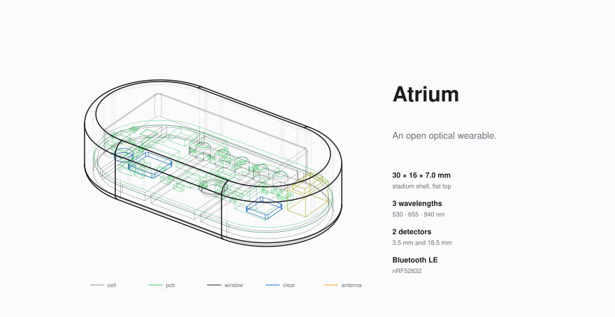
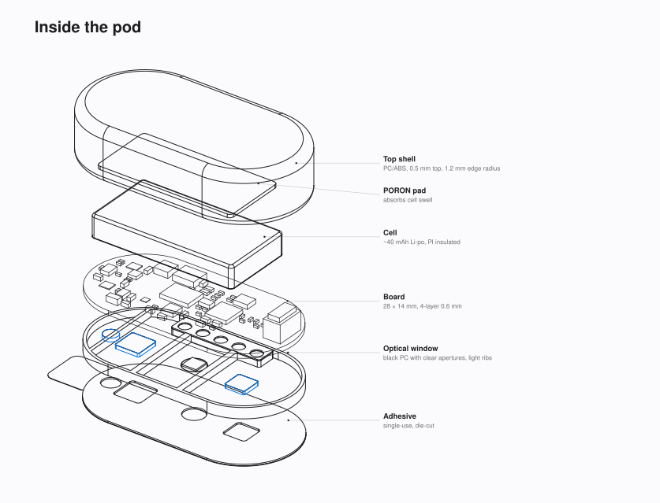
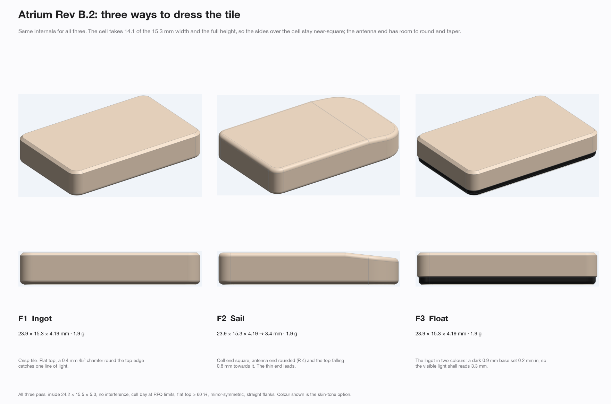
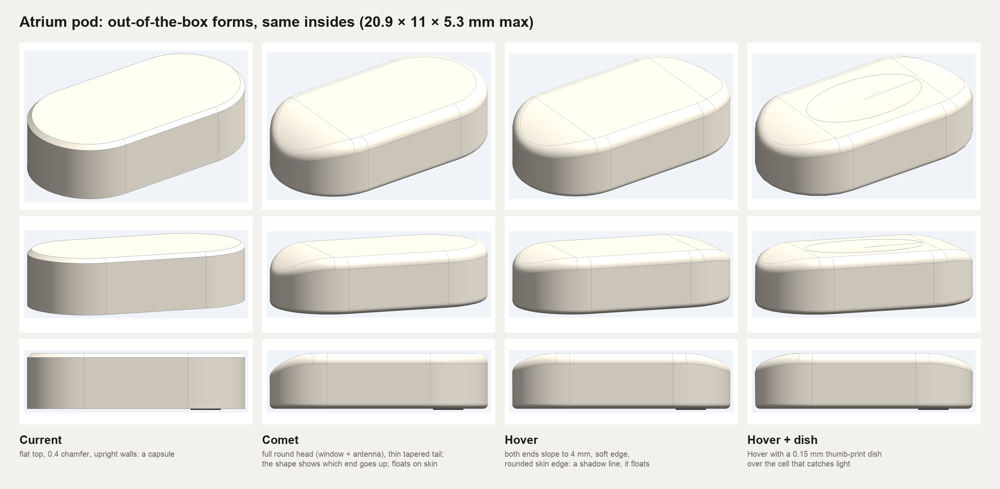

# Legacy designs

Earlier revisions and the ideas that were tried on the way to the EVT pod. Nothing here is maintained; it is kept so
contributors can see what was already explored and why it was left. The current design is in `hardware/`,
`mechanical/` and `firmware/`.

  
  
   Rev B.1: the 28 × 14 mm pod that started it.

  
   Rev B.2: the single-board forms drawn around the optical module.

  
   EVT form studies. The capsule won.

| Version | When | What it was | Why it was dropped |
|---|---|---|---|
| [Rev B.1](rev-b1/) | 2026-11-05 | 28 × 14 mm stadium pod on a 0.6 mm 4-layer board: nRF52832, a discrete optical front end (MAX86174A, SFH 7016 LEDs, two VEMD5080 photodiodes, one 18.5 mm away as a far channel), LSM6DSV16X IMU, TMP117 skin sensor, fuel gauge. 40 × 26 mm two-layer charging case with BQ24073 and USB-C | Too large for something worn on the head (about 3,360 mm³). A Monte Carlo of the optics showed the far channel added little signal for the 8 mm it cost. The schematic simulation also found an I²C address clash (AFE and IMU both at 0x6A) |
| [Rev B.2 compact](rev-b2-compact/) | 2026-11-06 | The MAXM86161 module (LEDs, photodiode and AFE in one 2.9 × 4.3 mm part) replaced the discrete optics; cell capped at 30 mAh; two charging pads. Many single-board forms were drawn around it: Tile, Wedge, Slate, Ingot, Sail, Float, Facet, Bow, Blade, E Slim, Disc, Pill and Pill S | A single board under the cell could not hold the parts at these sizes with real clearances, and the small cells the forms assumed were not stocked. The EVT baseline splits the electronics into two islands around a centred 9 × 9 mm cell |
| [Concepts](concepts/) | 2026-11-07 / 08 | Form studies on the final EVT insides (Gem, Seed, Comet, Line, Hover, Hover with a dish), a skin cradle, case-button options | The capsule won: flat top, one continuous side wall, satin silver-grey. The cradle was replaced by a flat frame, a 0.05 mm bed and a hidden disposable pad |

## Decisions carried into EVT

- **Size.** The pod is 20.9 × 11 × 5.3 mm. 19.4 mm was tried first and did not fit its parts with proper margins; the
  length is set by the radio end (flex tongue, optical window and antenna zone).
- **Boards.** Islands moved from 4-layer 0.6 mm to 6-layer HDI 0.82 mm: four layers could not escape the nRF52832
  WLCSP, and the standard multilayer service starts at 0.8 mm.
- **Optics.** One module instead of discrete parts: fewer parts, a smaller window, and green, red and IR from one spot.
- **Case.** From a USB-C case with a power-path charger to a smaller two-layer case with a linear charger, a boost
  converter and a small MCU that talks to the pod over its contacts.
- **Skin attachment.** From a foam ring and cradle to a hidden 0.15 mm pad in a bed under the pod. Lessons kept from the
  adhesive study: a full pad with one small hole peels less than a ring, the edge carries the peel load, and an
  IBOA-free medical acrylic is preferred on facial skin.
- **Firmware and app.** The Rev B.2 firmware was ported to the EVT board; the app design study became the Flutter app.

Formats here are as they were: STEP, STL and 3MF for parts, DXF for board outlines, PDF schematics, PNG renders. Some
Rev B.1 file names carry the revision suffix `revB1-1`.
