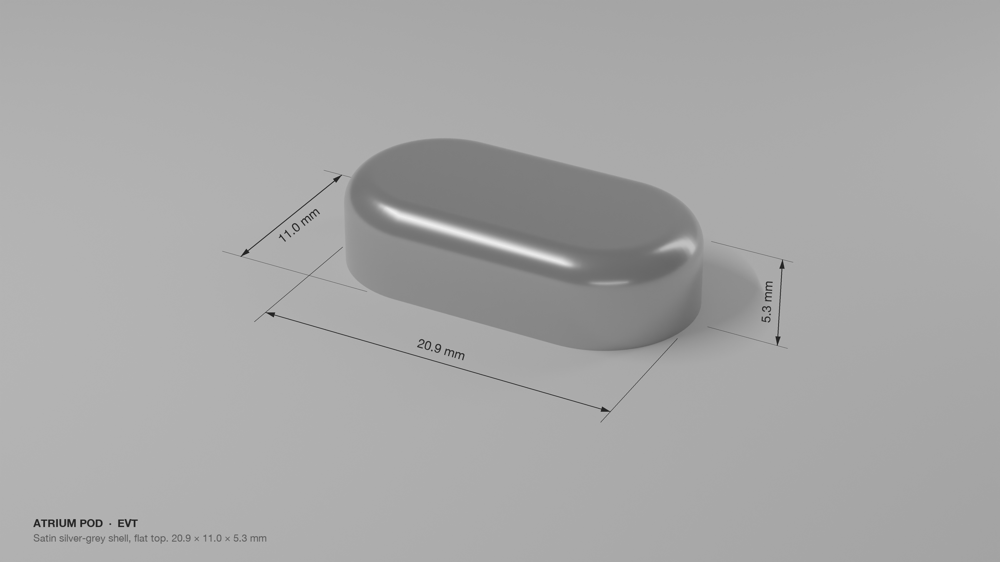
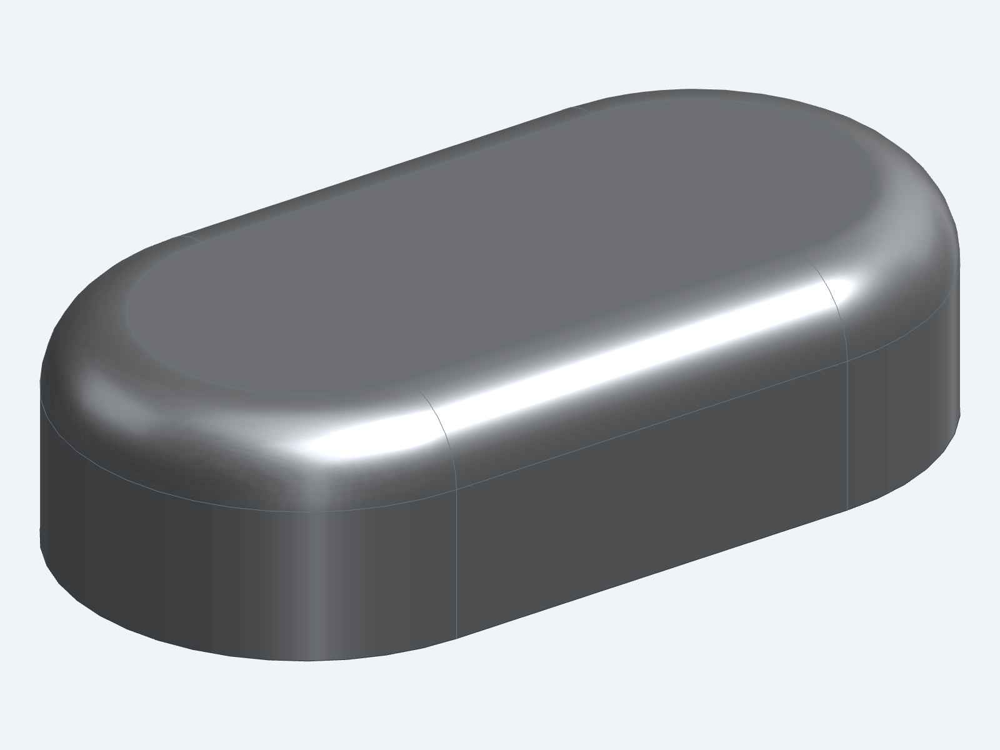
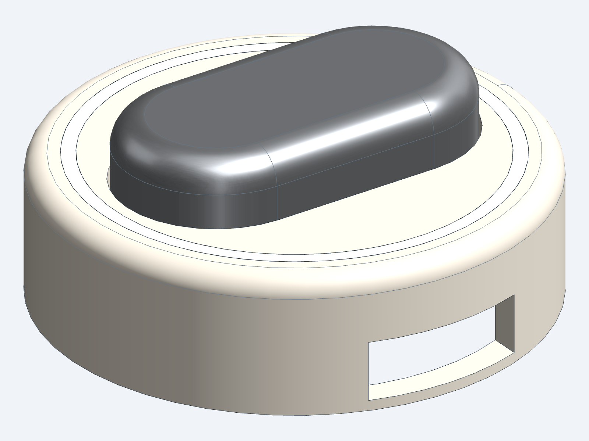
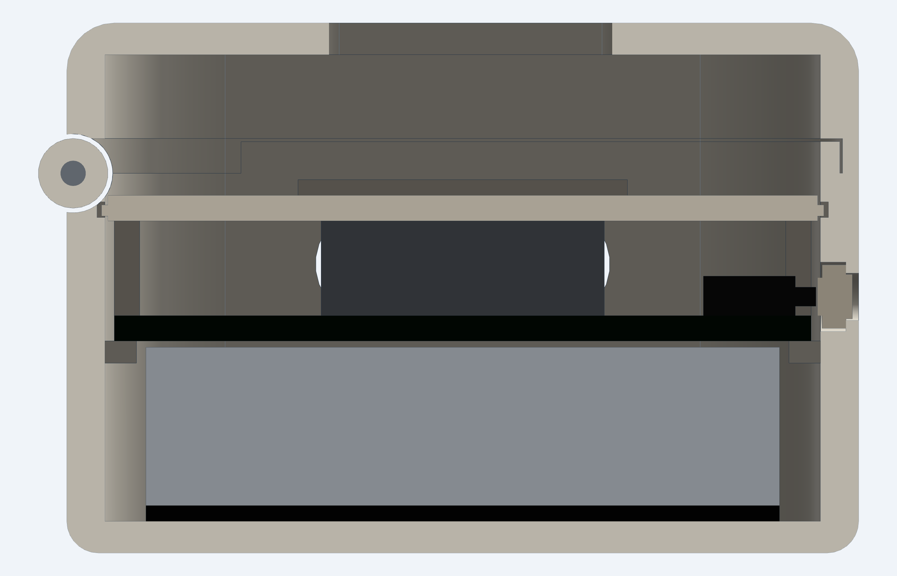
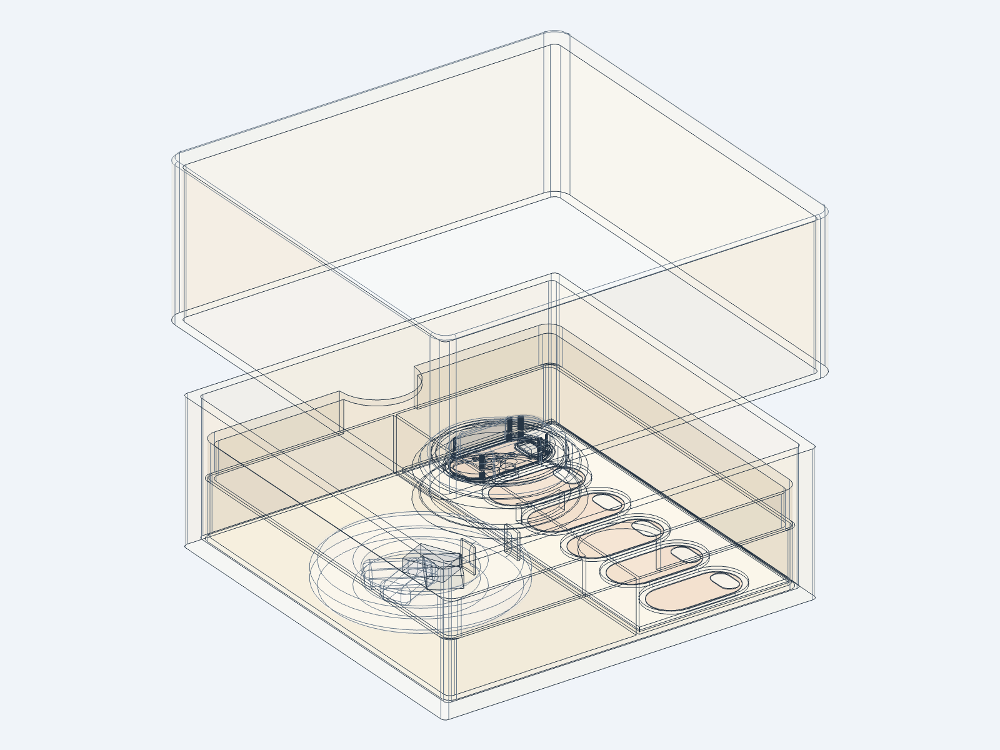
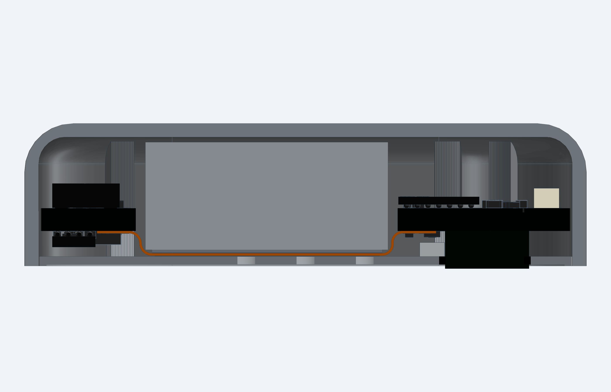
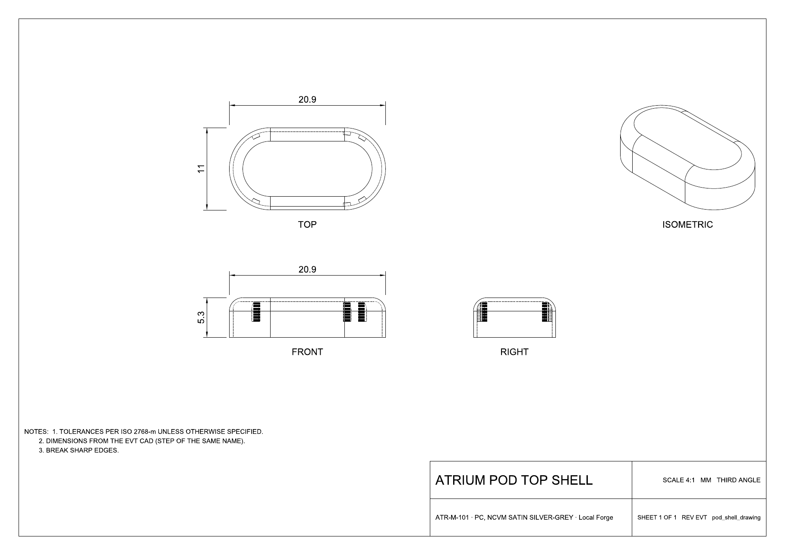
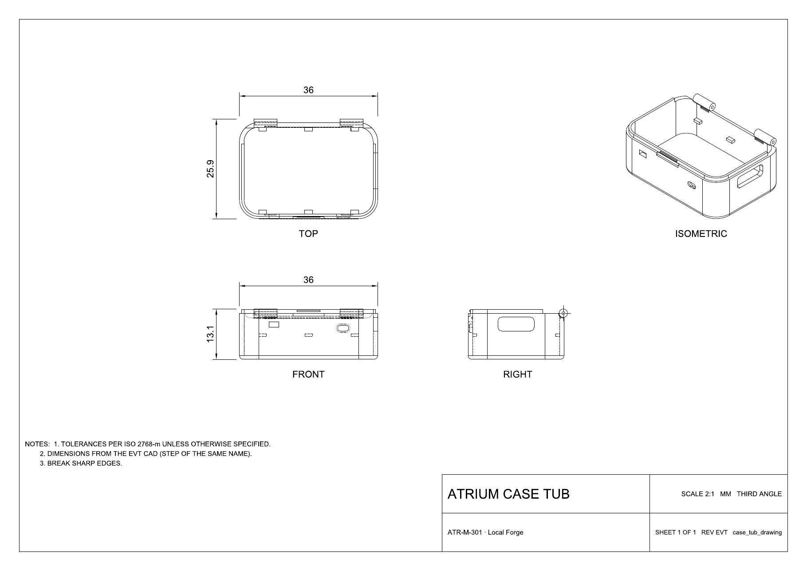

# Mechanical

The enclosure parts of the Atrium EVT build, as drawings, solid models and meshes. Design notes are in
[`docs/mechanical.md`](../docs/mechanical.md).

  

  
  
  
  

  
   Section through the closed pod: shell, both islands, the flex and the cell.

  
  
   Every part has a dimensioned drawing in its <code>drawings/</code> folder.

| Folder | Parts |
|---|---|
| `pod/` | Top shell, base plate, window gasket, skin pad; assemblies (on the pad, in the skin, with routed boards); `reference-bodies/` for the cell, islands, flex, optical module and stiffener |
| `case/` | Tub, deck, lid, button and light pipe; the full assembly; the case PCB outline (DXF) |
| `plinth/` | Plinth housing and the pod on the Plinth |
| `programming-jig/` | Jig that holds a pod on its SWD contacts |
| `packaging/` | Box, pulp tray and card insert |
| `renders/` | Product renders and sections |
| `reports/` | Interference and fit-check results |

Each part folder holds:

| Folder | Format | Use |
|---|---|---|
| `drawings/` | PDF | Reference drawings: four views, overall dimensions, ISO 2768-m general tolerance. The STEP file is the master geometry |
| `STEP/` | STEP AP214 | CAD, CNC, tooling quotes |
| `STL/` | STL | 3D printing (SLA for the pod, FDM or SLA for the case, Plinth and jig) |
| `GLB/` | glTF binary | Viewing in a browser and product renders |
| `DXF/` | DXF | Die-cut lines for the skin pad and adhesive; case PCB outline and keep-outs |

The pod is 20.9 × 11 × 5.3 mm. Production intent for the shell is injection-moulded PC with an NCVM satin silver-grey
finish (non-conductive, because the antenna sits 0.3 mm from the wall); a builder version prints in SLA resin with a
mica silver paint. The base is PC or PA12, the gasket black LSR silicone or TPU 85A.

Licensed under the CERN-OHL-S v2 with the rest of the hardware; see [`LICENSE`](../LICENSE).
